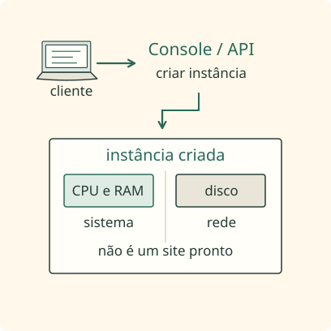
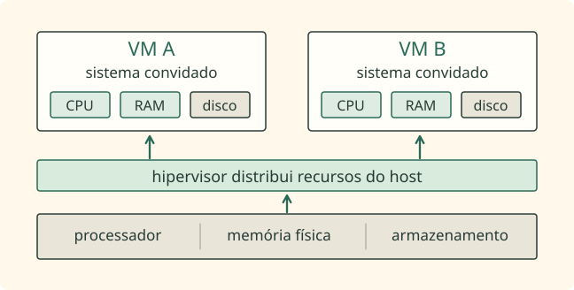
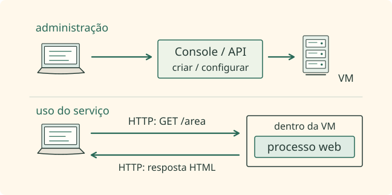
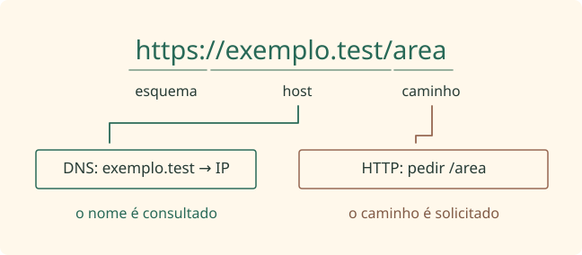
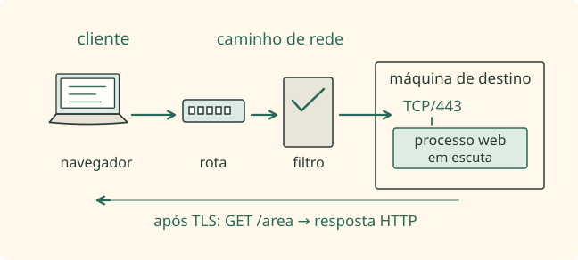
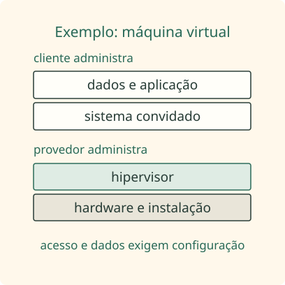
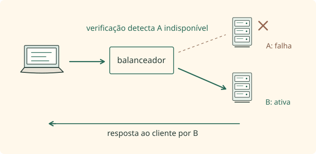
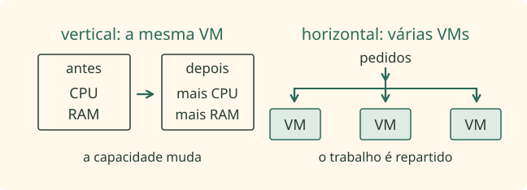

Contexto e fundamentos / Aula 3

# O que é computação em nuvem?

A máquina aparece no painel, mas onde ela existe e o que precisa acontecer para que alguém consiga usá-la?

## Pedir um recurso, sem montar o computador { #a-nuvem-como-modelo-de-uso }

Imagine que um programa precise de mais memória do que seu computador possui. Comprar e instalar outra máquina é uma possibilidade; solicitar capacidade por uma interface de software é outra. Chamamos de <mark aria-describedby="def-modelo-0">computação em nuvem</mark> o modelo que disponibiliza recursos computacionais pela rede, sob demanda e com administração por software. A mudança principal está na maneira de obter e gerenciar a capacidade, não no desaparecimento dos computadores.

<aside class="definition-card" aria-labelledby="def-modelo-0-title">
  
computação em nuvem

  
Modelo de fornecimento de recursos computacionais por rede, com administração por software e uso conforme a necessidade.

</aside>

Entre clicar no painel e conseguir usar o recurso há uma preparação: o serviço reserva capacidade, cria os elementos necessários e aplica a configuração solicitada. Esse trabalho é o <mark aria-describedby="def-modelo-1">provisionamento</mark>. O pedido pode envolver CPU, memória e disco, mas também uma rede virtual, um banco de dados, uma fila ou uma função. Guardar arquivos é apenas um dos usos possíveis.

<aside class="definition-card" aria-labelledby="def-modelo-1-title">
  
provisionamento

  
Preparação e disponibilização dos recursos necessários. Pode incluir criar uma máquina e configurar sua rede.

</aside>

<figure class="lesson-figure lesson-figure--square" markdown>

{ width="408" height="408" loading="lazy" decoding="async" }

</figure>

O modelo reúne características que se apoiam mutuamente: o cliente solicita recursos por autosserviço, acessa-os pela rede, compartilha infraestrutura com isolamento, ajusta a capacidade e tem seu uso medido. O autosserviço dispensa a instalação física manual pelo cliente a cada pedido; não dispensa autorização, cotas nem pagamento. Uma operação tecnicamente simples ainda pode consumir um recurso cobrado.

Por isso, “está longe de mim” não é um teste suficiente para reconhecer nuvem. Um computador alugado em outro lugar pode ser apenas um servidor remoto convencional. Para compreender a oferta, investigue como os recursos são disponibilizados, ajustados, compartilhados e mensurados. A localização explica a distância; essas características explicam o modelo de serviço.

## A nuvem continua tendo cabos, discos e calor { #a-nuvem-continua-sendo-infraestrutura-fisica }

O painel apresenta nomes e configurações, mas o trabalho acontece em equipamentos concretos. Nos <mark aria-describedby="def-hardware-0">datacenters</mark>, computadores ficam organizados em racks, sistemas de armazenamento mantêm dados e dispositivos de rede encaminham comunicações. O símbolo de nuvem é uma simplificação visual dessa estrutura, não uma descrição de onde os dados flutuam.

<aside class="definition-card" aria-labelledby="def-hardware-0-title">
  
datacenters

  
Instalações que abrigam equipamentos de computação e sua infraestrutura de energia, rede, refrigeração e proteção física.

</aside>

Essa estrutura precisa receber energia, remover calor e controlar quem consegue alcançar os equipamentos. Geradores, refrigeração e monitoramento ajudam a sustentar a operação. Quando a interface esconde esses detalhes, ela simplifica o trabalho do cliente; não torna a infraestrutura independente de manutenção ou de condições físicas.

Como um único equipamento pode atender máquinas diferentes? Uma possibilidade é usar um <mark aria-describedby="def-hardware-1">hipervisor</mark>, a camada de virtualização que administra a distribuição dos recursos físicos. Cada máquina virtual recebe uma visão própria de capacidade, enquanto o sistema de virtualização mantém a separação lógica entre os ambientes. Essa separação não exige que cada cliente tenha um gabinete exclusivo.

<aside class="definition-card" aria-labelledby="def-hardware-1-title">
  
hipervisor

  
Camada que permite criar e executar máquinas virtuais usando recursos de um computador físico.

</aside>

<figure class="lesson-figure" markdown>

{ width="648" height="328" loading="lazy" decoding="async" }

</figure>

A máquina virtual enxerga processador, memória, disco e interfaces de rede como componentes do seu ambiente. Em muitos serviços, a máquina criada para o cliente recebe o nome de instância. “Criar uma instância”, portanto, significa disponibilizar aquele recurso lógico, não necessariamente instalar um computador físico dedicado.

Há ofertas em que o cliente nem administra uma máquina diretamente. Em um banco de dados gerenciado, sua atenção se concentra nos dados e nas permissões, enquanto o serviço cuida de mais partes da infraestrutura. A operação física continua existindo, mas a fronteira entre o que o cliente gerencia e o que o provedor gerencia muda.

## Criar a máquina não é atender uma página { #o-que-e-um-servidor-remoto }

Há uma diferença entre administrar a máquina e conversar com o programa que roda nela. O <mark aria-describedby="def-controle-0">plano de controle</mark> é a parte que recebe operações de criação, alteração e remoção de recursos. Você pode acioná-lo por um Console web ou por uma API, interface que permite a um programa solicitar operações a outro. Esses mecanismos administram a instância; não são o site que ela poderá hospedar.

<aside class="definition-card" aria-labelledby="def-controle-0-title">
  
plano de controle

  
Conjunto de painéis, APIs e mecanismos que administra os recursos. Não é a aplicação em execução na instância.

</aside>

Uma instância recém-criada pode estar ligada, com sistema e rede configurados, e ainda assim não atender nenhuma página. Para haver um site, algum programa precisa estar instalado, configurado e em execução dentro do ambiente adequado. O sucesso da criação comprova uma etapa de administração, não o funcionamento de toda a aplicação.

É nesse ponto que a palavra <mark aria-describedby="def-controle-1">servidor</mark> costuma confundir. Ela pode nomear o equipamento físico, a máquina virtual ou o programa que atende solicitações. Ao investigar uma falha, pergunte de qual sentido se está falando: o computador existe, a VM está ligada ou o processo que presta o serviço está funcionando? Cada pergunta trata de um estado diferente.

<aside class="definition-card" aria-labelledby="def-controle-1-title">
  
servidor

  
Neste contexto, programa que recebe pedidos e fornece um serviço. A palavra também pode nomear a máquina que o executa.

</aside>

<figure class="lesson-figure" markdown>

{ width="648" height="322" loading="lazy" decoding="async" }

</figure>

Na comunicação web, o navegador solicita um recurso e o processo servidor interpreta o pedido para produzir uma resposta. Esses são os papéis de cliente e servidor naquela conversa. Chamar a máquina de “servidor” é comum, mas quem efetivamente entende o protocolo e responde é o programa executado nela.

Já “remoto” informa que o acesso vem de outro dispositivo pela rede. O destino pode estar em um datacenter, em um escritório ou em uma casa. O mesmo aparelho pode atuar como cliente ao pedir um recurso e como servidor ao atender outra comunicação. Nenhum desses nomes, isoladamente, permite concluir que o ambiente seja nuvem.

## Rede local, Internet e Web não são sinônimos { #rede-local-internet-e-web }

Antes de seguir o pedido até a máquina remota, precisamos entender o caminho. Uma rede, chamada de network em inglês, reúne dispositivos e interfaces capazes de trocar dados segundo protocolos, isto é, regras de comunicação. Uma <mark aria-describedby="def-rede-0">LAN</mark> é a rede local de um ambiente como uma casa ou escritório. Nela, um notebook pode conversar com uma impressora sem que a troca precise atravessar a Internet.

<aside class="definition-card" aria-labelledby="def-rede-0-title">
  
LAN

  
Local Area Network: rede local que conecta dispositivos num ambiente como casa, escritório ou laboratório.

</aside>

Quando redes se interligam, a comunicação pode alcançar destinos além daquele ambiente local. A <mark aria-describedby="def-rede-1">Internet</mark> é essa interligação de redes usando a família TCP/IP. Os dados atravessam o caminho em unidades chamadas pacotes; roteadores os encaminham conforme as rotas disponíveis. A rede não precisa conhecer a finalidade de cada página para encaminhar essa comunicação.

<aside class="definition-card" aria-labelledby="def-rede-1-title">
  
Internet

  
Interligação de redes que permite encaminhar comunicações entre dispositivos usando a família de protocolos TCP/IP.

</aside>

Sobre essa infraestrutura funcionam serviços diferentes. A <mark aria-describedby="def-rede-2">Web</mark> reúne documentos e aplicações acessados principalmente com HTTP ou HTTPS. Correio eletrônico, DNS e acesso remoto com SSH também usam redes, mas não passam a ser Web por isso. A estrada compartilhada não transforma todos os veículos no mesmo serviço.

<aside class="definition-card" aria-labelledby="def-rede-2-title">
  
Web

  
Conjunto de documentos e aplicações acessados por protocolos web. É um serviço sobre redes, não a Internet inteira.

</aside>

<figure class="lesson-figure" markdown>

{ width="648" height="350" loading="lazy" decoding="async" }

</figure>

O alcance também varia: um site interno pode funcionar apenas na LAN, e uma aplicação hospedada em nuvem pode aceitar somente caminhos privados. Usar um protocolo web descreve como a aplicação conversa; não estabelece quem consegue chegar até ela. Essa exposição depende de configuração.

Assim, as três palavras respondem a perguntas distintas. Rede trata da comunicação; Web identifica serviços e protocolos de aplicação; nuvem caracteriza a oferta e a administração de recursos. Ver uma página no navegador comprova que houve atendimento web naquele acesso, mas não revela sozinho qual modelo de infraestrutura o responsável escolheu.

## Um endereço, um nome e um recurso { #ip-dominio-url-e-porta }

Para encaminhar um pacote, a rede precisa de identificação apropriada. Um <mark aria-describedby="def-identificacao-0">endereço IP</mark> identifica uma interface ou ponto lógico usado na comunicação IP. Ele permite orientar o encaminhamento, mas não descreve sozinho a página desejada nem garante que um processo esteja pronto para responder.

<aside class="definition-card" aria-labelledby="def-identificacao-0-title">
  
endereço IP

  
Identificador de uma interface ou ponto lógico na rede, usado no encaminhamento dos pacotes.

</aside>

Pessoas normalmente trabalham com nomes, não com endereços numéricos. O domínio é um nome hierárquico, e o <mark aria-describedby="def-identificacao-1">DNS</mark>, Domain Name System, publica registros associados a nomes. Alguns registros permitem obter um ou mais endereços. A consulta fornece uma informação para localizar o destino; ela não é a transferência da página que será solicitada depois.

<aside class="definition-card" aria-labelledby="def-identificacao-1-title">
  
DNS

  
Sistema de nomes que publica registros. Alguns relacionam domínios a endereços IP; outros têm funções diferentes.

</aside>

O endereço completo de um recurso é uma <mark aria-describedby="def-identificacao-2">URL</mark>. Em https://exemplo.test/area, o esquema https orienta o tipo de acesso, exemplo.test identifica o host e /area é o caminho solicitado à aplicação. Uma URL ainda pode incluir porta e outros componentes. Consultar um nome no DNS não significa consultar também o caminho /area.

<aside class="definition-card" aria-labelledby="def-identificacao-2-title">
  
URL

  
Endereço de um recurso. Pode reunir esquema, host, porta e caminho; não é apenas um domínio.

</aside>

<figure class="lesson-figure" markdown>

{ width="648" height="284" loading="lazy" decoding="async" }

</figure>

O nome usado aqui é deliberadamente de teste: .test é um sufixo reservado e não deve ser tratado como um serviço público real. Ele permite examinar a estrutura da URL sem direcionar o estudante a um sistema de outra pessoa. O exemplo descreve as partes do endereço; não é uma promessa de resolução na Internet.

Mesmo depois de receber um IP correto, o navegador tem trabalho a fazer. Ele precisa estabelecer a comunicação, atravessar as regras aplicáveis e encontrar o serviço esperado. Por isso, uma resposta DNS correta pode coexistir com uma página que não abre: a identificação funcionou, mas outra condição ainda pode estar ausente.

## Como um pedido encontra quem atende { #como-uma-requisicao-chega-a-um-servico-hospedado }

O destino de transporte também inclui uma <mark aria-describedby="def-caminho-0">porta de rede</mark>, número lógico entre 0 e 65535. Ela participa da identificação das comunicações e ajuda o sistema a entregá-las ao processo apropriado. Não é um conector do gabinete: abrir uma porta física e ter um programa em escuta são assuntos diferentes.

<aside class="definition-card" aria-labelledby="def-caminho-0-title">
  
porta de rede

  
Número lógico que participa da identificação das comunicações de transporte. HTTPS tradicional costuma usar TCP/443.

</aside>

No HTTPS tradicional adotado como modelo nesta aula, a conexão começa com TCP destinado à porta 443. TCP oferece um fluxo ordenado de bytes. Sobre ele, TLS negocia a proteção criptográfica; só então as mensagens HTTP transportam os pedidos e as respostas da aplicação de forma protegida. São funções sobrepostas, não três nomes para a mesma operação.

Para esse início chegar ao destino, o sistema escolhe uma rota e a rede encaminha os pacotes. Na infraestrutura de nuvem, o caminho pode envolver um gateway, que liga caminhos de rede, ou um balanceador, que distribui conexões. A arquitetura determina quais componentes aparecem. O nome “nuvem” não substitui essas dependências.

Ao longo do percurso, <mark aria-describedby="def-caminho-1">firewalls</mark> podem permitir ou recusar tráfego segundo regras. Se os controles aceitarem a chegada, o sistema de destino ainda precisa encontrar um processo em escuta naquele endereço e porta. É esse processo que recebe a comunicação da aplicação, interpreta o pedido e produz a resposta.

<aside class="definition-card" aria-labelledby="def-caminho-1-title">
  
firewalls

  
Controles que filtram tráfego segundo regras. Permitir uma conexão não cria o programa que vai atendê-la.

</aside>

O resultado útil só aparece quando a resposta retorna ao cliente. Acompanhar apenas o trajeto de ida deixa o diagnóstico incompleto. Resolução, rota, filtros, escuta e retorno são partes do mesmo atendimento; cada evidência observada confirma somente as etapas que realmente participaram daquele teste.

<figure class="lesson-figure" markdown>

{ width="648" height="292" loading="lazy" decoding="async" }

</figure>

## Permitir tráfego não é iniciar um serviço { #permitir-trafego-nao-e-iniciar-um-servico }

Considere uma VM que recebeu um IP público. Esse endereço resolve a identificação externa, mas não instala o programa nem libera todos os caminhos. O atendimento requer uma combinação coerente de rota, regras da infraestrutura, firewall do sistema e processo ativo. Uma configuração não executa automaticamente o trabalho das demais.

Duas situações deixam essa diferença visível. Na primeira, a rede permite TCP 443, mas não existe processo esperando nessa porta: a aplicação não será atendida. Na segunda, o programa responde localmente, porém um filtro recusa o acesso externo. Testar o processo dentro da VM e testar a chegada pela rede são verificações complementares.

Na AWS, um <mark aria-describedby="def-exposicao-0">Security Group</mark> participa desse controle junto à interface da instância. Suas regras consideram elementos como protocolo, porta e origem para permitir conexões. Salvar a regra não cria um servidor web, não instala o programa e não garante que ele consiga ler o conteúdo que deverá publicar.

<aside class="definition-card" aria-labelledby="def-exposicao-0-title">
  
Security Group

  
Controle virtual de tráfego associado à interface de uma instância. Sua regra não inicia o programa servidor.

</aside>

<figure class="lesson-figure" markdown>

{ width="648" height="350" loading="lazy" decoding="async" }

</figure>

O mesmo raciocínio vale fora da nuvem. Uma máquina em rede local pode publicar um serviço se existir o caminho necessário. Dependendo da rede, esse caminho envolve <mark aria-describedby="def-exposicao-1">NAT</mark>, tradução de endereços, além de encaminhamento de porta e filtros. Essas escolhas precisam ser conhecidas para interpretar de onde a comunicação vem e a qual destino chega.

<aside class="definition-card" aria-labelledby="def-exposicao-1-title">
  
NAT

  
Network Address Translation: tradução de endereços de rede. Seu efeito depende da configuração do caminho.

</aside>

Traduzir um endereço e encaminhar uma porta não são operações idênticas. A tradução modifica endereços conforme a configuração; o encaminhamento associa determinada comunicação recebida a um destino interno. Nenhuma delas significa permissão ética para testar qualquer máquina alcançável. Autorização do exercício e possibilidade técnica de comunicação continuam sendo requisitos separados.

## Público e privado: depende do que você descreve { #publico-e-privado-tres-distincoes }

Quando alguém diz que um recurso é “público”, é preciso descobrir o que está sendo classificado. Nuvem pública descreve uma oferta de infraestrutura para vários clientes, com isolamento lógico. Nuvem privada descreve uma infraestrutura destinada a uma organização. Esse primeiro sentido não diz, por si só, se uma máquina aceita visitantes externos.

Em outro sentido, um <mark aria-describedby="def-publico-0">IP público</mark> é um endereço roteável pela Internet, enquanto endereços privados são usados em espaços de redes internas. A diferença trata do alcance e do uso do endereçamento. Ambos são endereços IP válidos; chamar apenas um deles de “real” atrapalha a compreensão.

<aside class="definition-card" aria-labelledby="def-publico-0-title">
  
IP público

  
Endereço roteável pela Internet. Não é garantia de que uma porta esteja permitida ou de que um serviço responda.

</aside>

Existe ainda a exposição do serviço: uma aplicação pública foi preparada para aceitar conexões externas, enquanto uma aplicação privada depende de caminhos controlados. Aqui, o resultado vem da combinação de endereço, controles e configuração da própria aplicação. Só observar o rótulo comercial do provedor não permite deduzir essa exposição.

Uma VM criada em nuvem pública pode usar apenas endereçamento privado. Da mesma maneira, uma organização com nuvem privada pode publicar um site. Esses exemplos não são contradições: modelo de infraestrutura, tipo de endereço e acesso ao serviço são classificações independentes.

Na documentação do laboratório, complete a frase em vez de registrar somente “é público”. Informe se está descrevendo o modelo do provedor, o IP da interface ou o atendimento da aplicação. Essa precisão evita abrir acesso desnecessário por confundir o lugar onde o recurso foi criado com o alcance que ele deveria ter.

## Hospedagem não transfere toda a responsabilidade { #provedor-e-hospedagem }

Quem opera a infraestrutura e oferece sua capacidade como serviço é o provedor. AWS, Azure e Google Cloud são exemplos, mas seus recursos, preços, Regiões, controles e políticas não são intercambiáveis. Entender o modelo geral ajuda a comparar ofertas sem presumir que uma configuração de um provedor existe igual em outro.

<mark aria-describedby="def-responsabilidade-0">Hospedar</mark> uma aplicação é mantê-la em infraestrutura que consiga sustentá-la e atendê-la. Isso também vale para serviços internos e dados acessíveis apenas por caminhos privados. Portanto, perguntar onde algo está hospedado é diferente de perguntar quem pode acessá-lo.

<aside class="definition-card" aria-labelledby="def-responsabilidade-0-title">
  
Hospedar

  
Manter recursos numa infraestrutura que possa atendê-los. Não significa deixá-los abertos à Internet.

</aside>

A contratação não transfere todas as tarefas de segurança. A <mark aria-describedby="def-responsabilidade-1">responsabilidade compartilhada</mark> distribui obrigações conforme o serviço usado. Em uma VM, o provedor normalmente administra instalações, hardware e virtualização, enquanto o cliente administra o sistema convidado, a aplicação, identidades, dados e suas configurações de acesso.

<aside class="definition-card" aria-labelledby="def-responsabilidade-1-title">
  
responsabilidade compartilhada

  
Divisão de responsabilidades entre provedor e cliente. Os serviços escolhidos determinam quem administra cada camada.

</aside>

<figure class="lesson-figure lesson-figure--square" markdown>

{ width="408" height="408" loading="lazy" decoding="async" }

</figure>

Ao escolher um serviço mais gerenciado, a divisão pode mudar: o cliente deixa de operar algumas camadas, mas ainda precisa compreender as tarefas que permanecem suas. Ocultar a máquina não elimina decisões sobre permissões, dados e acesso. A responsabilidade acompanha a arquitetura contratada, não apenas a palavra nuvem.

O custo exige o mesmo cuidado com as partes. Consumo, assinatura e capacidade reservada são formas diferentes de cobrança; armazenamento, tráfego e endereços podem ter regras próprias. Uma aplicação sem visitantes não significa infraestrutura sem despesas. Conferir os recursos que continuam existindo é parte do encerramento do laboratório.

## Um recurso na nuvem também pode parar { #disponibilidade }

Uma aplicação pode estar hospedada e, ainda assim, não atender quando alguém precisa dela. Sua <mark aria-describedby="def-disponibilidade-0">Disponibilidade</mark> expressa a condição de permanecer acessível e funcionar corretamente no momento necessário. Criar uma instância na nuvem não estabelece, automaticamente, funcionamento sem interrupções.

<aside class="definition-card" aria-labelledby="def-disponibilidade-0-title">
  
Disponibilidade

  
Condição de um serviço poder ser acessado e funcionar corretamente quando necessário.

</aside>

<figure class="lesson-figure" markdown>

{ width="648" height="315" loading="lazy" decoding="async" }

</figure>

Falhas físicas, defeitos em programas, problemas de rede e erros de configuração continuam possíveis. A manutenção também pode afetar o atendimento. Se todos os clientes dependem da mesma instância, uma falha nela alcança o serviço inteiro; a simplicidade inicial passa a ser uma dependência importante.

Para reduzir esse risco, arquiteturas de alta disponibilidade costumam combinar recursos redundantes, verificações de integridade e distribuição de carga. Também consideram domínios de falha: grupos de componentes que podem ser afetados pelo mesmo problema. Distribuir recursos entre esses grupos ajuda a evitar que uma única dependência derrube todas as alternativas.

Ter uma alternativa só ajuda se o sistema percebe a falha e consegue usá-la. Monitoramento, recuperação e testes verificam esse comportamento. Duplicar uma VM sem examinar rede, dados e demais dependências pode apenas duplicar a mesma fragilidade. O desenho mostra uma relação possível, não uma garantia universal.

Os compromissos contratados podem ser registrados em um <mark aria-describedby="def-disponibilidade-1">SLA</mark>, Service Level Agreement. O acordo descreve condições de nível de serviço, mas não impede fisicamente que uma falha aconteça. Para compreender a disponibilidade real, é preciso considerar o contrato junto da arquitetura, da operação e dos testes.

<aside class="definition-card" aria-labelledby="def-disponibilidade-1-title">
  
SLA

  
Service Level Agreement: acordo de nível de serviço. Define compromissos; não elimina a possibilidade de falhas.

</aside>

## Crescer não é o mesmo que permanecer disponível { #escalabilidade-e-elasticidade }

Outro problema surge quando o serviço funciona, mas recebe mais trabalho do que consegue executar. A <mark aria-describedby="def-escala-0">Escalabilidade</mark> é a capacidade de suportar essa carga maior mantendo o nível de atendimento esperado. Ela depende de como os recursos e a aplicação crescem, e não apenas de adicionar máquinas ao desenho.

<aside class="definition-card" aria-labelledby="def-escala-0-title">
  
Escalabilidade

  
Capacidade de suportar carga maior mantendo o nível de serviço esperado.

</aside>

Crescer verticalmente significa dar mais capacidade à mesma máquina, como CPU ou memória. Crescer horizontalmente significa repartir o trabalho entre mais instâncias. A segunda opção exige que a aplicação e os dados consigam operar nesse arranjo. Algumas tarefas se dividem bem; outras dependem de coordenação que limita o ganho.

A <mark aria-describedby="def-escala-1">Elasticidade</mark> acrescenta a ideia de acompanhar a demanda nos dois sentidos: disponibilizar mais recursos quando necessário e reduzi-los quando a necessidade diminui. Um ambiente que só aumenta e nunca consegue voltar pode ser escalável, mas não apresenta o mesmo comportamento elástico.

<aside class="definition-card" aria-labelledby="def-escala-1-title">
  
Elasticidade

  
Capacidade de aumentar e reduzir recursos conforme a demanda, dentro das condições da arquitetura.

</aside>

<figure class="lesson-figure" markdown>

{ width="648" height="234" loading="lazy" decoding="async" }

</figure>

Mais capacidade também traz decisões: quem distribui as solicitações, como manter os dados coerentes e quanto custa o conjunto? Limites de rede, da aplicação e do provedor podem impedir ganhos proporcionais. A escolha de escala deve responder à necessidade observada, não à expectativa de que recursos adicionais resolvam qualquer gargalo.

Ao terminar esta aula, separe essas três perguntas: o serviço está disponível, consegue suportar mais carga e consegue ajustar capacidade conforme a demanda? As respostas podem ser diferentes para a mesma aplicação. Na próxima aula, esse vocabulário será usado para explicar o papel da infraestrutura remota em testes autorizados, sem confundir conveniência com permissão ou anonimato.
