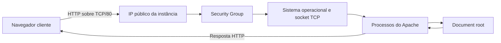

# Apache, HTTP e exposição de um serviço web

Por que uma página pode funcionar dentro do servidor e continuar inacessível no seu navegador? Essa pergunta exige separar o programa que atende, o arquivo solicitado e o caminho de rede. Trabalhe somente na sua instância de laboratório com conteúdo inofensivo, sem malware e sem páginas que recebam credenciais reais.

Reutilizaremos máquina remota, IP e porta da [aula 3](../01-introduction-to-cloud-computing-for-hackers/03-what-is-the-cloud.md), o canal SSH da [aula 8](../02-cloud-basics/08-communicating-with-cloud-computers-remotely-using-ssh.md) e a interpretação de comandos e caminhos da [aula 9](../02-cloud-basics/09-linux-terminal-basics.md). A [aula 10](10-introduction-to-phishing.md) permite distinguir esse funcionamento web da influência sobre uma pessoa.

Execute os comandos desta aula no Kali remoto, depois de entrar por SSH. As respostas mencionadas são critérios de interpretação e verificação, não resultados produzidos durante esta reescrita. Nenhuma instalação ou abertura de porta na AWS foi executada aqui.

## O que é o Apache

Apache HTTP Server é o programa que interpreta solicitações web e produz respostas. No Kali e em distribuições da família Debian, o pacote usado para instalá-lo normalmente recebe o nome `apache2`.

Aqui, “servidor” pode nomear duas coisas: a máquina, física ou virtual, que oferece recursos e o software que implementa o atendimento. Quando o software começa a executar, ele passa a existir como processo, com recursos e identidade administrados pelo sistema. A função duradoura de atendimento é gerenciada como serviço.

Isso permite separar três estados: arquivos do Apache presentes no disco, processos do Apache executando e o serviço `apache2` sendo administrado pelo sistema. Instalação não é evidência suficiente de execução, e execução não é prova de alcance público.

Um serviço pode usar mais de um processo. Ao reiniciá-lo, os identificadores dos processos podem mudar sem que a unidade lógica deixe de se chamar `apache2`. O nome do serviço permite administrar essa função sem depender de um ID fixo.

## HTTP sobre TCP e IP

Para pedir um recurso, navegador e servidor precisam concordar sobre a forma da conversa. HTTP, de *Hypertext Transfer Protocol*, define essas requisições e respostas na camada de aplicação.

No cenário desta aula, os dados HTTP passam por TCP, que fornece o fluxo ordenado de bytes. IP permite o encaminhamento dos pacotes, e a porta de destino identifica a comunicação a ser atendida. São responsabilidades complementares, não nomes diferentes para o mesmo mecanismo.

Uma porta é um identificador lógico, e a porta padrão de HTTP é `80`. Quando ela não aparece explicitamente em uma URL HTTP, o cliente usa esse padrão. Por isso, o endereço:

```text
http://<IP-PUBLICO-DO-LAB>/
```

seleciona a mesma porta de destino que a forma explícita:

```text
http://<IP-PUBLICO-DO-LAB>:80/
```

## Fluxo de uma requisição



A iniciativa é do navegador: ele tenta estabelecer TCP com o endereço público na porta `80`. A AWS encaminha o tráfego até a interface, e o Security Group aplica as condições de entrada. Se houver passagem e um processo em escuta, o sistema entrega a comunicação ao Apache.

O Apache então interpreta o pedido, procura ou produz o recurso correspondente e devolve uma resposta HTTP pelo canal. O conteúdo não sai do disco apenas porque uma regra foi criada: precisa existir software atendendo, configuração adequada e recurso disponível.

Da mesma forma, iniciar o software não muda automaticamente o filtro da AWS. Ao diagnosticar o acesso, preserve essa separação entre permissão de tráfego e capacidade de atendimento.

## Requisição e resposta HTTP

Para entender o que chega ao Apache depois da conexão, considere este pedido simplificado de uma imagem. É um exemplo de mensagem HTTP, não um comando de shell:

```http
GET /files/one.jpg HTTP/1.1
Host: <IP-PUBLICO-DO-LAB>
```

`GET` indica o método de solicitação do recurso, e `/files/one.jpg` informa seu caminho. `HTTP/1.1` identifica a versão da conversa; o campo `Host` informa o destino usado na requisição. Esse caminho não é, por si só, um caminho livre para qualquer arquivo do sistema.

Se o recurso for atendido com sucesso, a resposta pode começar pelas linhas abaixo. O tipo declarado ajuda o cliente a interpretar o conteúdo recebido:

```http
HTTP/1.1 200 OK
Content-Type: image/jpeg
```

Se o caminho não corresponder a um recurso disponível, o servidor pode responder:

```http
HTTP/1.1 404 Not Found
```

Observe o alcance dessa evidência: `404` é uma resposta do protocolo, portanto houve atendimento web, embora o recurso solicitado não tenha sido encontrado. Isso é diferente de uma falha que nem consegue estabelecer a comunicação.

Recusa de conexão ou tempo esgotado não são códigos HTTP. Nesses casos, a investigação começa no transporte, no listener e no caminho de rede, não na escolha do nome de um arquivo servido. Confundir essas camadas pode levar a alterar regras sem necessidade.

## Document root

O document root é o diretório que funciona como base para localizar o conteúdo publicado. Ele cria uma relação entre o caminho pedido pela Web e os arquivos que a configuração permite servir.

Em uma configuração comum de Kali ou Debian, essa base é:

```text
/var/www/html
```

Se essa for a configuração em uso, `/files/one.jpg` pode ser atendido pelo arquivo `/var/www/html/files/one.jpg`, e `/pagina.html`, por `/var/www/html/pagina.html`. Uma solicitação de `/` pode resultar na entrega de `/var/www/html/index.html`, conforme a regra de índice.

A relação não é universal nem dá ao navegador acesso irrestrito ao disco. A configuração do Apache determina a base e o atendimento dos recursos. Para diagnosticar um arquivo ausente, confira tanto o caminho solicitado quanto a base efetivamente configurada.

## O papel de `index.html`

Quando o caminho pedido é um diretório, como `/`, não há um nome de arquivo explícito na solicitação. O Apache normalmente consulta sua configuração de índice e procura um nome como `index.html`.

Assim, esta URL:

```text
http://<IP-PUBLICO-DO-LAB>/
```

pode fazer o servidor entregar o conteúdo deste arquivo:

```text
/var/www/html/index.html
```

Isso depende da configuração de índice: o nome não é uma propriedade obrigatória de toda página web. Distinguir o caminho visível na URL do arquivo escolhido pelo servidor ajuda a compreender por que a página inicial pode aparecer sem que `index.html` seja digitado.

## APT e privilégios administrativos

Antes de iniciar o Apache, o pacote precisa estar disponível no sistema. Kali usa APT para administrar pacotes e suas dependências. Essas operações modificam o sistema e podem exigir privilégio administrativo, mas ainda não representam publicação de uma página na Internet.

### Atualizar o índice

Comece atualizando o conhecimento local sobre os pacotes oferecidos pelos repositórios configurados. No Kali remoto:

```bash
sudo apt update
```

`sudo` pede a execução do comando seguinte com privilégios permitidos pela política; `apt` é a ferramenta de pacotes, e `update` renova os índices locais. Leia o resultado e confirme a conclusão sem erros antes de seguir.

O que mudou foram metadados sobre versões e pacotes disponíveis. Esse comando não atualiza automaticamente todos os programas já instalados. Também não torna a sessão inteira permanentemente `root`: o privilégio solicitado por `sudo` se aplica à operação autorizada.

### Instalar Apache

Com os índices consultados, solicite a instalação do pacote do servidor:

```bash
sudo apt install apache2
```

Depois de `apt`, a operação `install` pede a instalação, e `apache2` identifica o pacote. O APT informa dependências e uso de espaço; examine essa proposta antes de confirmar. Ao concluir, ainda será necessário consultar o estado do serviço, porque a existência do pacote não basta para demonstrar atendimento.

Uma página HTML estática não precisa de um interpretador PHP. Não acrescente PHP a esta instalação apenas por estar trabalhando com um site: ele não é necessário ao conteúdo inofensivo e estático desta aula.

## Gerenciamento do serviço

Quando o sistema usa `systemd` para administrar serviços, `systemctl` é a ferramenta de consulta e controle dessas unidades. Iniciar, verificar e parar são operações diferentes; uma deve produzir a mudança e a outra deve conferir o resultado.

### Iniciar

Para solicitar o início do atendimento pelo Apache no Kali remoto:

```bash
sudo systemctl start apache2
```

Na linha, `systemctl` chama a administração de unidades, `start` solicita o início e `apache2` seleciona o serviço. A autorização administrativa vem de `sudo`. O comando pode terminar sem texto; isso não dispensa uma leitura separada do estado.

A próxima consulta, `systemctl is-active apache2`, é a verificação apropriada para saber se a unidade ficou ativa. Mesmo uma unidade ativa ainda não comprova que o navegador externo consegue alcançá-la.

### Verificar

Consulte o estado ativo sem solicitar uma nova inicialização:

```bash
systemctl is-active apache2
```

Se precisar de contexto e mensagens recentes, peça o status sem abrir um paginador:

```bash
systemctl --no-pager status apache2
```

`--no-pager` mantém o texto diretamente na saída, `status` escolhe a consulta de estado e `apache2` indica a unidade. Leia as mensagens junto do estado informado para distinguir um serviço ativo de uma tentativa de início que falhou. Não presuma uma saída que ainda não foi observada no laboratório.

### Alternativa com `service`

Existe também uma interface de compatibilidade para solicitar a mesma ação:

```bash
sudo service apache2 start
```

Aqui, `service` recebe o nome `apache2` e a ação `start`. Não é uma segunda etapa obrigatória depois de `systemctl`: ambos representam uma forma de pedir o início. Quando houver systemd, prefira `systemctl` e não duplique a solicitação sem motivo.

## Verificar a porta em escuta

Além do estado do serviço, procure a condição de rede local: um socket TCP aguardando na porta `80`. Use:

```bash
sudo ss -ltnp 'sport = :80'
```

O programa `ss` consulta sockets. Em `-ltnp`, `-l` limita a escuta, `-t` seleciona TCP, `-n` mantém endereços e portas numéricos e `-p` inclui informação de processo quando permitida. O filtro `sport = :80` seleciona a porta local. Procure um listener associado ao atendimento web, sem supor antecipadamente qual linha aparecerá.

Se houver `0.0.0.0:80`, o significado é escuta na porta `80` das interfaces IPv4 locais. Esse endereço de escuta não é a faixa CIDR `0.0.0.0/0` usada em uma regra do Security Group: um descreve interfaces locais atendidas; o outro descreve origens de tráfego permitidas.

## Testar localmente

Antes de atribuir uma falha à AWS, teste a conversa HTTP dentro da própria instância:

```bash
curl -I http://127.0.0.1/
```

`curl` atua como cliente, e `-I` solicita os cabeçalhos da resposta. O endereço `127.0.0.1` aponta para a própria máquina em que o comando executa, aqui o Kali. Como a URL usa HTTP e não declara outra porta, a tentativa utiliza `80`.

Uma linha de estado HTTP mostra que houve resposta de um servidor local; o código permite interpretar o atendimento. Esse caminho não passa pela Internet nem pelo Security Group. Portanto, sucesso local não é prova de acesso externo, mas ajuda a separar a aplicação do restante da rede.

## Examinar o document root

Se a dúvida envolver o conteúdo publicado, examine o diretório usado nesta configuração:

```bash
ls -la /var/www/html
```

`ls` lista, `-l` inclui detalhes e `-a` mostra também entradas ocultas. O argumento `/var/www/html` escolhe o diretório a consultar, sem mudar o diretório atual nem modificar os arquivos.

Para confrontar o pedido de `/files/one.jpg` com o arquivo correspondente nessa base, consulte:

```bash
ls -l /var/www/html/files/one.jpg
```

A existência do arquivo é apenas uma das condições; a identidade usada pelo servidor também precisa ter o acesso apropriado. Não aplique `chmod 777` como correção genérica. Primeiro identifique quem precisa acessar o quê e qual restrição está impedindo o atendimento.

## Security Group

O Security Group aplica regras de tráfego à interface da instância. Para este acesso HTTP, a regra deve corresponder ao tipo HTTP, ao protocolo TCP, à porta de destino `80` e à faixa CIDR das origens autorizadas.

CIDR é uma forma de expressar um conjunto de endereços por um prefixo. A regra não diz qual arquivo será entregue nem instala ou inicia o Apache; ela apenas permite conexões que correspondam às condições.

Como o controle acompanha o estado das conexões, a resposta correspondente à entrada aceita pode retornar. Isso resolve uma parte do caminho, mas não substitui endereço público, rota e controles do sistema operacional.

## O significado de `0.0.0.0/0`

Uma origem que exige atenção especial na configuração é:

```text
0.0.0.0/0
```

Em uma regra de entrada, essa faixa significa qualquer endereço IPv4 de origem. O prefixo `/0` não exige coincidência de nenhum bit; assim, toda a faixa IPv4 pode corresponder à regra.

Ela não representa o endereço da instância e não seleciona automaticamente o computador do estudante. Usá-la é permitir a entrada de qualquer origem IPv4 compatível com o restante da regra. Essa exposição só é adequada quando o acesso público foi intencionalmente incluído na autorização.

Para limitar a um único IPv4, a forma é:

```text
<SEU-IP-PUBLICO>/32
```

O prefixo `/32` exige a coincidência dos 32 bits daquele IPv4. Substitua o marcador pelo endereço público atual do computador que fará o teste, não pelo endereço de destino da instância. Em IPv6, a faixa que abrange qualquer origem é `::/0`; ela também representa exposição ampla, não um atalho para acesso restrito.

## Configurando o acesso no laboratório AWS

No Console, encontre o Security Group realmente associado à instância e abra as regras de entrada. Acrescente HTTP e confira se o protocolo é TCP e a porta de destino é `80`. Escolha a origem conforme o escopo, salve e só então faça o teste usando o endereço público atual da máquina.

Se o único participante for o estudante, restrinja ao seu IP público com `/32`. A opção `0.0.0.0/0` só deve ser escolhida quando o objetivo permitido exigir uma página publicamente acessível; ela não é necessária para provar o funcionamento a partir de uma origem conhecida.

Mesmo uma regra correta não cria endereço público nem rota. Se a configuração do laboratório não fornecer esse caminho, a permissão do Security Group não será suficiente. Corrija a condição identificada, sem ampliar origens como tentativa genérica de resolver qualquer falha.

## Porta permitida versus serviço ativo

| TCP/80 permitido | Apache escutando | Resultado |
|---|---|---|
| Não | Não | Sem serviço e sem entrada permitida |
| Não | Sim | Teste local pode funcionar; público bloqueado |
| Sim | Não | Tráfego chega, mas não há processo para atender |
| Sim | Sim | Pode funcionar se endereço, rota e controles estiverem corretos |

A tabela separa duas condições independentes, mas não lista todas as dependências da rede. Mesmo com entrada permitida e Apache em escuta, endereço, rota e outros controles precisam estar corretos. O painel AWS mostra permissão de tráfego; a resposta da porta exige um processo alcançável que realmente atenda.

## Verificando uma camada de cada vez

A investigação progride de dentro para fora. Confira a instalação e o estado com `systemctl is-active apache2`; em seguida, use `ss` para confirmar a escuta TCP/80 e `curl` para obter uma resposta local. Cada observação acrescenta uma prova que a anterior não fornecia.

Depois examine o grupo associado, a origem da regra e o IP público atual, e tente abrir `http://<IP-PUBLICO-DO-LAB>/` do computador autorizado. Se o teste local respondeu e o externo não, há motivo para concentrar a investigação no caminho externo. Se nem o local responde, mudar a entrada na AWS não resolve primeiro a aplicação.

## Interpretação de falhas

| Resultado | Interpretação inicial |
|---|---|
| `curl` local falha | Serviço, listener ou configuração local |
| `curl` local funciona, público falha | Security Group, IP, rota ou outro controle |
| Conexão recusada | Destino alcançado, sem listener ou rejeição local |
| Tempo esgotado | Tráfego filtrado, sem rota ou sem resposta |
| Página padrão | Serviço e caminho padrão funcionando |
| `404 Not Found` | Apache respondeu, mas não encontrou o recurso |
| `403 Forbidden` | Apache respondeu, mas recusou o recurso |

Essas interpretações são pontos de partida, não diagnósticos universais. Uma página padrão demonstra atendimento do caminho padrão, enquanto `403` ou `404` já são respostas HTTP com problemas de autorização ou de recurso. Recusa e tempo esgotado precisam de investigação anterior ao conteúdo.

Altere uma condição por vez e repita a verificação que poderia demonstrar seu efeito. Trocar serviço, arquivo e regra ao mesmo tempo impede saber qual mudança corrigiu o problema e pode deixar uma exposição desnecessária sem ser percebida.

## Encerramento

No fim do exercício, solicite a parada do serviço web no Kali:

```bash
sudo systemctl stop apache2
```

Nessa linha, `stop` pede ao `systemctl` que pare `apache2`, usando o privilégio autorizado por `sudo`. Confira depois o estado do serviço e a ausência da escuta que você pretendia encerrar. Retire também a regra temporária TCP/80 e confirme o fim da exposição; parar um processo e remover uma permissão são ações distintas.

Por último, pare ou termine a instância conforme a continuidade do laboratório e revise recursos restantes e cobrança. O que deve ficar compreendido é o encadeamento completo: regra permite tráfego, processo atende a porta, HTTP identifica o recurso e document root relaciona a solicitação ao conteúdo publicado. Uma evidência em qualquer elo não substitui a conferência dos demais.
