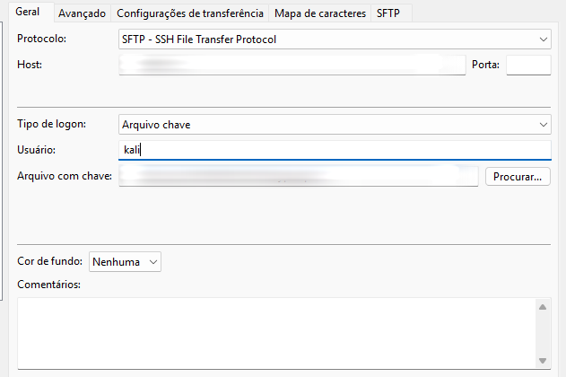
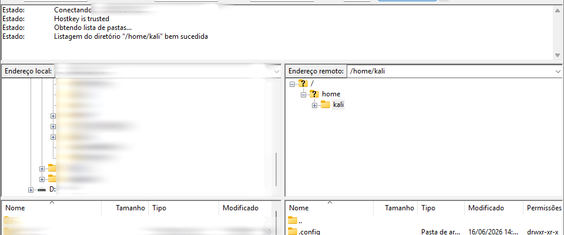

# Clonando páginas e enviando arquivos para a nuvem

> **Título original:** Cloning Websites & Uploading Them to The Cloud  
> **Duração:** 8 minutos  
> **Escopo:** use somente páginas próprias ou criadas para um laboratório autorizado.

Uma página que abre no Windows já está disponível no servidor? Para responder, precisamos acompanhar a mudança de lugar dos arquivos, sem confundi-la com a publicação na Web. O ponto de partida é a [instância Kali e seu key pair](../02-cloud-basics/07-installing-kali-linux-on-the-cloud.md), com [acesso SSH](../02-cloud-basics/08-communicating-with-cloud-computers-remotely-using-ssh.md). Os [caminhos do Linux](../02-cloud-basics/09-linux-terminal-basics.md) permitem localizar o destino, e o [servidor Apache](11-file-hosting-and-firewall-settings.md) será responsável pelo atendimento HTTP, não pela transferência realizada aqui.

## Cópia estática de uma página

O navegador precisa receber recursos para desenhar uma página. A opção **Salvar página como → Página da Web, completa** tenta reunir esses recursos no armazenamento local. Conforme o que estiver acessível, o conjunto salvo pode incluir:

- **HTML:** estrutura e conteúdo textual;
- **CSS:** regras de aparência;
- **JavaScript:** código enviado ao navegador;
- imagens, fontes e outros recursos acessíveis.

Chamamos esse conjunto de **cópia estática local**: arquivos disponíveis no computador para representar parte da página recebida. A palavra “cópia” não significa que o navegador tenha trazido a aplicação inteira. Ele só pode salvar aquilo a que teve acesso; não ganha acesso ao funcionamento interno do servidor.

Há, portanto, uma fronteira entre a aparência recebida e os componentes que continuam fora desse conjunto:

- código de back-end executado no servidor;
- banco de dados;
- lógica real de autenticação;
- APIs privadas;
- sessões de usuários;
- serviços externos;
- conteúdo obtido dinamicamente depois do carregamento.

Mesmo a aparência pode não se conservar por inteiro. Uma URL absoluta ainda pode apontar ao site de origem, um recurso externo pode deixar de responder e políticas como CSP e CORS podem impedir carregamentos ou acessos. Abrir o HTML e ver uma estrutura semelhante não comprova que todas as dependências foram salvas.

> [!NOTE]
> Abrir o arquivo salvo no navegador não o publica na Internet. Ele continua armazenado somente no computador local.

Para separar o aprendizado técnico desses riscos, o material de treino deve ser uma página própria e inofensiva. Um título, alguns parágrafos e uma imagem sem dados pessoais já permitem observar caminhos e dependências. Campos de senha, envio de informações, formulários reais e cópias de marcas não são necessários para verificar se um arquivo chegou ao destino e ficam fora do exercício.

O resultado procurado é reconhecer os arquivos na máquina remota e entender como chegaram até ela. Obter credenciais não participa desse objetivo nem serve como evidência de uma transferência correta.

## O que é SFTP

Como mover esse conjunto sem expor seu conteúdo no caminho? A comunicação estudada usa **SFTP**, sigla de **SSH File Transfer Protocol**. Trata-se de um protocolo de operações sobre arquivos, transportado pelo canal protegido do SSH. O cliente pede uma operação, e o componente remoto a executa com os direitos da conta autenticada.

Quando o arquivo sai do computador local e vai para a instância, fazemos um **upload**. No sentido contrário, trazê-lo da instância para o computador é um **download**. A mesma sessão permite consultar tamanho, data e permissões, listar pastas ou solicitar criação, renomeação e remoção de itens. Cada operação continua dependendo da autorização do usuário sobre o caminho escolhido.

Aqui o serviço SSH já foi preparado na [aula 8](../02-cloud-basics/08-communicating-with-cloud-computers-remotely-using-ssh.md). Por isso, o cliente normalmente alcança a porta TCP `22` da instância e se autentica como `kali` com a chave privada correspondente. A proteção do canal não muda as permissões dos arquivos: poder entrar na máquina não equivale a poder gravar em qualquer pasta.

### SFTP não é FTP

| Tecnologia | Proteção | Porta comum | Observação |
|---|---|---:|---|
| FTP | Sem criptografia nativa | `21` | Tecnologia antiga; autenticação e dados podem ficar expostos. |
| FTPS | FTP protegido com TLS | Varia | Continua sendo FTP, com TLS adicionado. |
| SFTP | Canal criptografado do SSH | `22` | Protocolo diferente, usado nesta aula. |

A comparação ajuda a corrigir a expressão “FTP sobre SSH”, usada na tradução. Acrescentar TLS ao FTP resulta em FTPS; usar SFTP é escolher outro protocolo, apoiado no SSH. Não há nesta aula uma sessão FTP convencional escondida dentro do canal seguro.

## O que é o FileZilla Client

Para realizar essas operações sem digitá-las no terminal, usamos o **FileZilla Client**. Ele apresenta os arquivos dos dois lados em uma interface gráfica e transforma ações como arrastar um item em pedidos de transferência ao servidor remoto.

Os papéis precisam ficar claros antes da conexão: o programa cliente roda no Windows; o sistema de arquivos consultado do outro lado pertence ao Kali na nuvem. É a infraestrutura SSH do Kali que oferece SFTP e atende às solicitações. O Windows não passa a hospedar o serviço por abrir a interface do FileZilla.

Essa arquitetura dispensa **FileZilla Server** no laboratório. Também não exige uma regra de rede específica para um suposto “protocolo FileZilla”: a comunicação escolhida continua sendo SSH/SFTP na porta `22` já utilizada, desde que sua configuração permaneça a mesma.

## Preparando os dois lados

Antes de preencher o perfil, confira os dois ambientes. No Windows devem estar o [FileZilla Client](https://filezilla-project.org/download.php?type=client), o navegador, a página segura com seus recursos e a chave `.pem` daquela instância. Do lado da AWS, a máquina deve estar ligada e alcançável pelo IP público ou DNS atual. A conta `kali` e o acesso SSH precisam corresponder à configuração da [aula 8](../02-cloud-basics/08-communicating-with-cloud-computers-remotely-using-ssh.md); dados de outra instância não servem para autenticá-la.

A chave é uma entrada de autenticação do cliente, não um recurso da página. Guarde-a separada do HTML e das imagens, fora de qualquer diretório publicado e de repositórios, para que uma transferência do site não a leve junto.

## Configurando o FileZilla

O perfil pode ser criado em **Arquivo → Gerenciador de Sites → Novo site**. Cada campo abaixo responde a uma parte da conexão: qual protocolo usar, onde encontrar o servidor e com qual identidade tentar entrar.

| Campo | Valor do laboratório |
|---|---|
| Nome do site | Nome descritivo, como `AWS Kali` |
| Protocolo | `SFTP - SSH File Transfer Protocol` |
| Host | IP público ou DNS atual da instância |
| Porta | `22` ou vazio para usar a porta padrão |
| Tipo de logon | Arquivo de chave |
| Usuário | `kali` |
| Arquivo de chave | Chave privada correspondente à instância |

*O perfil reúne os parâmetros do cliente SFTP; endereço IP e localização da chave privada foram desfocados na captura.*

Ao conectar pela primeira vez, um pedido de confirmação da chave de host diz respeito à identidade do servidor, não à chave que autentica `kali`. Antes de aceitar, compare a fingerprint com uma fonte confiável segundo a [aula 8](../02-cloud-basics/08-communicating-with-cloud-computers-remotely-using-ssh.md). Preencher corretamente o perfil não elimina essa verificação de confiança.

## Lendo a interface

Depois da conexão, leia a tela como duas localizações diferentes. À esquerda está o armazenamento local do Windows; à direita, a listagem obtida do Kali remoto. Acima aparecem mensagens de conexão e operações, úteis para explicar recusas. A parte inferior acompanha a fila e separa o que terminou do que falhou, evitando tratar uma tentativa como conclusão.

A direção do gesto determina o sentido da cópia. Levar um item da esquerda à direita solicita envio ao Kali; fazer o caminho inverso solicita recebê-lo no Windows. O arquivo não muda de máquina apenas porque uma pasta remota ficou visível.

*Os painéis separam o computador local, à esquerda, dos arquivos remotos, à direita; informações particulares estão desfocadas.*

## Transferindo a página para o Kali

Com os lados identificados, localize no painel local o HTML e a pasta de recursos que o acompanha. Abra `/home/kali` no painel remoto e envie o conjunto para esse destino. A evidência deve vir da fila, do log e de uma nova listagem: confira os nomes, os tamanhos e as datas apresentados no servidor. Assim, a verificação acompanha o efeito da operação em vez de se limitar ao gesto de arrastar.

Uma listagem já exibida pode continuar mostrando o estado anterior. Se um item recém-enviado não aparecer, use **Atualizar** para consultar novamente o servidor antes de concluir que a cópia falhou.

## Transferir não é publicar

Agora surge a distinção que orienta a próxima aula: receber arquivos no Kali e disponibilizá-los por HTTP são tarefas diferentes. Os caminhos abaixo participam delas de maneiras distintas:

| Diretório | Função nesta aula |
|---|---|
| `/home/kali` | Diretório pessoal do usuário; local adequado para receber e conferir arquivos. |
| `/var/www/html` | Document root comum do Apache; arquivos ali podem ser servidos por HTTP. |

Encontrar o arquivo em `/home/kali` confirma uma localização no armazenamento remoto. Não demonstra que o Apache o esteja entregando a navegadores, pois o serviço web não publica automaticamente todo o conteúdo da conta.

A publicação da página própria exige outra combinação: arquivo no document root correto, permissão de leitura apropriada e Apache atendendo às requisições. A [aula 11](11-file-hosting-and-firewall-settings.md) explica esse atendimento. O canal SFTP usado para administrar o arquivo e o canal HTTP usado para lê-lo têm funções independentes.

## O que as capturas comprovam

Nas capturas disponíveis, é possível reconhecer o perfil SFTP, o acesso como `kali` e a listagem de `/home/kali`, com os painéis local e remoto abertos. Esse é o alcance documental das imagens; elas não devem receber um significado maior do que o estado que mostram.

Em particular, **“Listagem do diretório `/home/kali` bem sucedida”** informa que o cliente conseguiu consultar aquela pasta com a conta autenticada. A mensagem não registra a conclusão de um envio e nada afirma sobre uma resposta do Apache.

Para documentar o envio, procure a conclusão da transferência e a presença do item remoto com nome e tamanho esperados. Atualizar a pasta e continuar vendo o arquivo ajuda a distinguir o conteúdo consultado no servidor de uma informação antiga na interface.

Outras palavras da tradução também podem atrapalhar essa leitura. “Carly” corresponde ao usuário `kali`, “var HTML” nomeia `/var/www/html` e “Localizador” é uma referência ao Finder do macOS, com papel semelhante ao Explorador de Arquivos do Windows. Reconhecer esses nomes evita procurar pastas ou contas que não existem.

## Problemas comuns

| Sintoma | Verificação |
|---|---|
| Tempo limite | Siga o diagnóstico de rede e porta `22` da [aula 8](../02-cloud-basics/08-communicating-with-cloud-computers-remotely-using-ssh.md). |
| Falha de autenticação | Confira usuário, chave correspondente e permissões da chave. |
| Aviso de chave de host alterada | Interrompa e valide a nova fingerprint antes de confiar. |
| `Permission denied` | Confirme o diretório remoto e as permissões do usuário `kali`. |
| Arquivo não aparece | Atualize a listagem e confira a fila de transferências. |
| HTML abre sem imagens ou CSS | Envie também a pasta de recursos e confira os caminhos. |
| Upload funciona, mas o site não aparece | O arquivo pode estar em `/home/kali`, não em `/var/www/html`. |
| Página remota retorna `403` ou `404` | Consulte permissões, document root e caminhos na [aula 11](11-file-hosting-and-firewall-settings.md). |

## Encerrando a transferência

Ao encerrar, considere tanto os arquivos quanto o estado da administração. Podem permanecer o perfil do FileZilla, a chave de host conhecida, registros de autenticação SSH, logs de operações e o material copiado. Se houve publicação posterior, existe ainda uma cópia no document root que não desaparece ao fechar o cliente.

Conserve apenas a evidência necessária ao estudo, sem segredos, e retire os arquivos de teste ao concluir. Fechar a janela de transferência encerra a interação do cliente, mas não limpa os recursos que foram deixados na instância.
