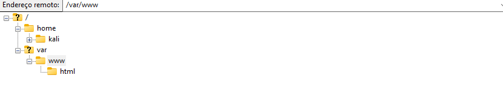
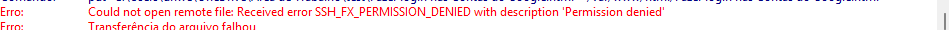
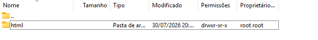
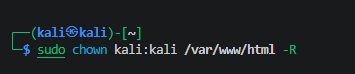
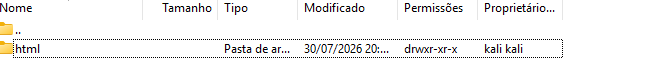

# Publicando uma página de laboratório no Apache

> **Status:** publicado.
>
> **Título original:** Creating a Fake Login Page on The Cloud
>
> **Escopo:** laboratório próprio, isolado e autorizado. Use uma página fictícia, sem marca real, senha ou coleta de dados.

## Antes de começar

Por que uma conexão que permite ver pastas pode recusar o envio de um arquivo? A página desta aula já estava salva e testada no computador, de modo que o problema aparece na escrita remota. A sequência acompanha uma tentativa recusada pelo servidor, a investigação da propriedade do diretório e uma nova transferência depois da alteração. Só ao final entra o nome `index.html`, que define qual arquivo o Apache entrega como página inicial nessa configuração.

Esse encadeamento deve ser estudado em instância própria, usando uma página fictícia que não copie marcas e não colete dados. O objetivo é explicar uma decisão de permissão, não colocar um formulário real em circulação.

## Abrindo o diretório do Apache no FileZilla

A primeira escolha foi o destino: no campo **Endereço remoto**, o instrutor informou `/var/www/html`, diretório usado pelo Apache apresentado no curso. O caminho começa na raiz do sistema Linux, representada por `/`, e percorre `var`, `www` e `html`. Digitar o caminho evita abrir cada pasta manualmente, mas leva ao mesmo local que a navegação pela árvore do painel.

[](assets/aula-13/01-diretorio-remoto-var-www-html.png)

*A árvore aberta no painel remoto permite reconhecer o caminho `/var/www/html` na instância.*

A captura precisa ser lida pelo lado certo da interface. A árvore pertence ao painel **remoto**, portanto mostra pastas da instância Kali. Ela não descreve o disco do Windows onde estava a página de origem.

## Tentando enviar a página

Com o destino aberto, arrastar o arquivo do painel local solicitou sua criação em `/var/www/html`. O log respondeu com `SSH_FX_PERMISSION_DENIED`, acompanhado de `Permission denied`: o servidor negou a operação por permissão insuficiente. O erro aparece durante a escrita, não durante a seleção do arquivo local, e por isso orienta a investigação para o acesso ao diretório remoto.

[](assets/aula-13/02-erro-permissao-filezilla.png)

*A recusa de criação aparece no log como resposta do servidor à tentativa de escrita.*

O fato de a listagem funcionar mostrava que ainda havia comunicação com a instância. A sessão SFTP estava autenticada como `kali`, mas o diretório tinha `root` como usuário e grupo. Autenticar uma conta permite identificá-la; autorizar a escrita exige também que as permissões do caminho concedam essa operação àquela identidade.

## Descobrindo a causa do erro

Em vez de refazer a conexão, o instrutor subiu um nível na árvore remota e examinou a linha de `html`. Esse movimento permitiu consultar as informações do próprio diretório que recusara o arquivo, aproximando o diagnóstico da operação que falhou.

[](assets/aula-13/03-propriedade-root-root.png)

*A listagem anterior à alteração associa o diretório ao usuário e ao grupo `root root`.*

A listagem combinava `drwxr-xr-x` com `root root`. Os dois nomes iguais representam campos diferentes: o primeiro identifica o usuário proprietário; o segundo, o grupo proprietário. Na permissão exibida, o proprietário possui escrita, enquanto os demais conjuntos mostrados não a concedem. Como a conta da sessão era `kali`, conseguir atravessar o caminho e ler a listagem não lhe dava o direito de criar o arquivo ali.

## Voltando ao terminal SSH

A interface de transferência revelou o problema, mas a correção apresentada foi feita pelo terminal. O instrutor retomou a sessão SSH da instância para executar uma operação administrativa sobre a propriedade do diretório.

A localização da execução é parte do significado do comando: ele atua **no Kali remoto**, através do SSH. O campo de endereço do FileZilla apenas navega entre caminhos; um CMD local sem conexão com a instância também não alteraria a propriedade do diretório Linux remoto.

## Alterando o proprietário do diretório

A linha registrada na captura deve ser reconhecida exatamente como foi usada no terminal da aula:

```bash
sudo chown kali:kali /var/www/html -R
```

[](assets/aula-13/04-comando-chown-terminal.png)

*A captura conserva a linha administrativa na forma exata em que foi executada na aula.*

O efeito começa com o privilégio solicitado por `sudo`, necessário para modificar um diretório ainda pertencente a `root`. O programa chamado é `chown`, de **change owner**. Sua tarefa é alterar os responsáveis pelo recurso no sistema de arquivos. Ele não transporta o HTML, não cria uma cópia da página e não substitui o envio pelo FileZilla.

Em `kali:kali`, o trecho antes de `:` escolhe a conta proprietária e o trecho depois dele escolhe o grupo. O argumento `/var/www/html` delimita o alvo da alteração. Embora os nomes se repitam, usuário e grupo continuam sendo propriedades independentes; aqui ambos passam a corresponder a `kali`.

A opção final `-R`, de **recursive**, amplia a operação para o conteúdo já existente: alcança o diretório, seus arquivos e seus subdiretórios. Isso exige atenção ao caminho, porque não se trata de alterar apenas um arquivo. A posição da opção ao final foi aceita pelo `chown` utilizado no Kali, ainda que seja comum encontrar opções escritas antes dos argumentos.

## Confirmando a mudança no FileZilla

Uma operação administrativa precisa ser seguida de verificação. Por isso, o instrutor retornou ao FileZilla e atualizou a pasta: a interface consultou novamente o servidor, em vez de continuar exibindo os metadados anteriores.

[](assets/aula-13/05-propriedade-kali-kali.png)

*Ao consultar novamente a pasta após o `chown`, as colunas de propriedade passam a exibir `kali kali`.*

A nova consulta conservou `drwxr-xr-x`, mas apresentou `kali kali` onde antes havia `root root`. Essa diferença é a evidência específica da mudança: não houve ampliação dos bits exibidos, e sim troca das identidades às quais eles se aplicavam. A conta usada pelo SFTP agora era a proprietária, de modo que a permissão de escrita do proprietário passou a permitir uma nova tentativa.

## Enviando a página novamente

Depois dessa confirmação, o arquivo foi novamente levado do painel local para `/var/www/html` no remoto. Repetir a mesma transferência após corrigir a condição que a impedia mantém clara a relação entre causa e resultado.

O registro gerado pelo FileZilla incluiu `put`, operação de envio do cliente ao servidor. Seus caminhos indicavam a origem no Windows e o destino na instância, dentro de `/var/www/html`. Essa linha pertence ao trabalho do cliente SFTP, não ao comando administrativo anterior. Separar os dois registros evita atribuir ao `chown` uma cópia que ele nunca realizou: a propriedade permitiu a escrita, e o FileZilla realizou a transferência.

## Tornando a página o arquivo inicial do site

Restava determinar o conteúdo da raiz do site. Na configuração observada, uma requisição apenas ao IP ou domínio, sem nome de arquivo, faz o Apache procurar `index.html` em `/var/www/html`. O arquivo enviado recebeu esse nome para corresponder à escolha de índice do servidor. Ao atualizar o navegador, a resposta passou a trazer `/var/www/html/index.html`. Esse comportamento depende da configuração mostrada, não de uma obrigação universal de qualquer servidor web.

## O que esta sequência ensina

Ao reconstruir a sequência, cada evidência responde a uma pergunta diferente. A listagem disponível mostrou comunicação; a recusa identificou uma escrita não autorizada; a troca de `root root` por `kali kali` confirmou a mudança de propriedade; o novo envio tratou da cópia do arquivo. Por fim, o nome de índice conectou o conteúdo armazenado à resposta do Apache na raiz. Assim, uma falha de permissão deixa de parecer uma desconexão misteriosa e passa a ser uma decisão explicável do sistema sobre uma conta, uma operação e um caminho.