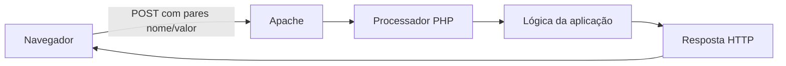
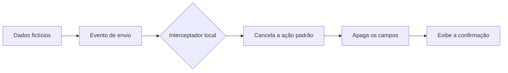

# Entendendo e controlando o envio de um formulário

> **Status:** publicado.
>
> **Título original:** Modifying The Page to Steal Login Information
>
> **Escopo:** estudo conceitual e simulação autorizada com dados fictícios. A coleta de credenciais reais demonstrada pelo instrutor não foi reproduzida.

Uma página pode estar visível no navegador sem que esteja claro o destino dos valores digitados nela. Na [aula anterior](13-creating-a-fake-login-page-on-the-cloud.md), o Apache passou a entregar `index.html` a partir de `/var/www/html`. Agora acompanharemos o que liga os campos desse documento a uma possível requisição: quem inicia o envio, como o destino é escolhido e em que momento o navegador ainda pode cancelar a ação.

No curso, o instrutor direcionou um formulário de phishing a um arquivo PHP destinado a receber credenciais. O laboratório registrado tomou outro caminho: compreender a estrutura sem repetir a coleta. A adaptação validada descarta valores fictícios dentro do navegador, sem capturá-los, transmiti-los ou armazená-los. A distinção entre o relato do curso e o comportamento testado acompanha toda a explicação.

## Abrindo o arquivo que o Apache entrega

Para alterar a página efetivamente publicada, era necessário localizar `/var/www/html/index.html` no painel remoto do FileZilla. Esse arquivo importava porque correspondia ao documento servido na raiz do site. Editar outra cópia, sem enviá-la a esse destino, não mudaria a resposta que o Apache estava entregando.

A opção **Editar** não abriu um editor dentro do Kali. Primeiro, o FileZilla trouxe uma cópia temporária ao Windows e acionou o programa associado a `.html`. A gravação feita nesse editor aconteceu localmente. Ao detectar a mudança, o cliente perguntou se deveria transferir o resultado de volta, substituindo o arquivo remoto. Portanto, o diálogo de confirmação era parte necessária do percurso entre editar e publicar a edição.

Podemos distinguir as duas direções envolvidas sem confundi-las com uma única edição remota:

1. **Download temporário:** o FileZilla traz o arquivo remoto para o computador local.
2. **Upload da alteração:** após a confirmação, o FileZilla envia a cópia editada para `/var/www/html/index.html`.

Essa diferença explica um sintoma comum: o editor pode mostrar a versão nova enquanto o site continua antigo. A conclusão do upload, e não apenas o ato de salvar, é que coloca a alteração no caminho lido pelo Apache.

## Relacionando a página visível ao código

Encontrar o trecho correto em um arquivo extenso exige relacionar a tela ao documento. Havia HTML, CSS, configurações e JavaScript misturados no material baixado. O instrutor começou pela região de entrada visível e usou **Inspecionar**, nas ferramentas de desenvolvimento, para reduzir a busca a elementos que participavam daquela interface.

No painel **Elements**, o navegador apresenta sua árvore de elementos. Ao apontar para um nó, uma marcação na página permite reconhecer a região correspondente. Essa ligação é útil para sair de uma pergunta visual, como “qual é este campo?”, e chegar ao elemento que o representa, sem adivinhar apenas pela posição no arquivo.

Um texto ou atributo característico encontrado ali pode orientar uma busca com `Ctrl+F` no editor. O propósito não é assumir que todo resultado é o correto, mas localizar um contêiner plausível e verificar sua relação com a área inspecionada. Assim, o arquivo grande passa a ser investigado a partir de uma referência concreta.

É preciso considerar também quando cada representação foi produzida. O inspetor mostra o **DOM atual**, a árvore que existe no navegador naquele instante. O editor mostra o **código-fonte armazenado**. Se JavaScript acrescentou ou alterou elementos depois do carregamento, as duas versões podem divergir. Uma busca sem correspondência literal não prova, sozinha, que o arquivo investigado seja o errado; pode refletir essa transformação em tempo de execução.

## O papel do elemento `form`

O agrupamento que interessa ao envio é o elemento `<form>`. Ele reúne controles que podem participar de uma mesma operação, como caixas de texto, seletores e botões. Estar perto visualmente de um campo não é o mesmo que compreender a relação desse controle com o formulário.

A estrutura pode ser observada com nomes fictícios e sem qualquer destino de coleta, como no exemplo seguro já adotado:

```html
<form action="#" method="post" onsubmit="event.preventDefault()">
  <label for="student-id">Identificador fictício</label>
  <input id="student-id" name="student_id" type="text" />

  <label for="test-code">Código de teste</label>
  <input id="test-code" name="test_code" type="text" />

  <button type="submit">Simular</button>
</form>
```

Ao solicitar o envio desse exemplo, `event.preventDefault()` cancela o comportamento padrão. É esse cancelamento que impede a transmissão nativa; `#` tampouco identifica um processador de dados. Os campos foram pensados para valores fictícios, permitindo estudar a relação entre atributos sem montar um receptor de informações.

### `action`: o destino da requisição

Antes de montar uma requisição nativa, o navegador precisa saber aonde enviá-la. O atributo `action` fornece essa URL. Ele funciona como indicação de destino, não como programa de validação ou armazenamento. Para produzir esses efeitos, o recurso destinatário precisaria oferecer lógica de aplicação, normalmente executada no back-end.

Um valor relativo, como `processar.php`, é interpretado a partir do endereço atual. No caso de uma página na raiz, ele normalmente designaria outro recurso do mesmo servidor. O efeito seria uma nova requisição HTTP ao caminho resultante; o atributo não abre diretamente um arquivo do sistema operacional remoto.

### `method`: como os valores entram na requisição

Depois do destino, vem a forma da requisição. O atributo `method` seleciona o método HTTP; no conteúdo da aula, ele era `POST`. Em formulários desse tipo, os controles participantes são representados como pares de nome e valor, normalmente transportados no corpo da mensagem.

Colocar esses pares no corpo não os cifra. `POST` descreve a semântica do pedido, enquanto TLS trata da proteção do transporte usada por HTTPS. Se a comunicação ocorre por HTTP sem TLS, o método não oferece por conta própria a proteção que impediria a leitura do conteúdo no caminho.

### `name`: a chave associada ao valor

O servidor precisa ainda distinguir a que campo cada valor pertence. Nos controles bem-sucedidos que participam do envio, `name` fornece essa chave. O texto exibido ao lado do campo e o nome enviado não precisam ser iguais, pois cumprem funções diferentes.

Para visualizar a associação, considere apenas conceitualmente `ALUNO-01` no controle chamado `student_id`. Caso houvesse um envio, esse par poderia ser representado assim, embora o exemplo seguro cancele a operação:

```text
student_id=ALUNO-01
```

Já `id` identifica o elemento dentro do documento. Um `<label>`, uma regra CSS ou um trecho de JavaScript pode usá-lo para se referir àquele campo. Portanto, `name` responde “qual chave acompanha o valor?”, enquanto `id` responde “qual elemento do DOM estamos identificando?”. Trocar um pelo outro não preserva automaticamente o comportamento.

## O botão de envio

O botão tradicional com `type="submit"` pede o envio do formulário associado. Antes de criar a requisição, o navegador dispara o evento `submit`, que abre espaço para a aplicação reagir. JavaScript pode conferir campos, cancelar a ação com `preventDefault()` ou iniciar um comportamento diferente. Por isso, a presença de um botão não basta para concluir que houve tráfego de rede.

A página analisada tornava essa distinção especialmente importante: o controle que aparecia na tela tinha `role="button"`, e existia também um `input` de envio oculto. O conjunto dependia de JavaScript. Não era, portanto, a mesma composição simples de `<button type="submit">` usada para introduzir o conceito.

Uma busca por `submit` poderia localizar o elemento oculto sem explicar o controle visível. A confirmação exige voltar ao inspetor e relacionar o resultado encontrado ao formulário e à área destacada. A investigação do mecanismo deve prevalecer sobre a escolha do primeiro texto que parece familiar.

## Por que remover um `id` não é uma regra geral

O instrutor retirou identificadores na tentativa de interromper o controle que os scripts originais exerciam sobre formulário e botão. Essa observação pertence à página demonstrada. Generalizá-la seria incorreto, porque scripts diferentes encontram elementos de maneiras diferentes e os identificadores também atendem a funções legítimas.

Ao retirar um `id` sem examinar suas referências, vários efeitos são possíveis:

- quebrar a associação entre `<label>` e campo;
- impedir que CSS encontre o elemento;
- interromper código JavaScript legítimo;
- prejudicar acessibilidade e testes automatizados;
- não produzir efeito algum, caso o código use classes, atributos ou referências internas.

O diagnóstico adequado pergunta qual código observa aquele elemento e por qual referência o encontra. Sem essa resposta, a edição pode quebrar a interface e, ainda assim, deixar o envio ativo. Uma mudança aparente na página não substitui a observação do comportamento.

## O limite entre HTML e PHP

Até aqui, tratamos de estrutura e eventos no navegador. Nenhum desses elementos HTML grava, por si só, um arquivo na instância. Receber o pedido, interpretar seus campos e persistir alguma informação exige execução do lado do servidor, com os recursos e permissões daquele ambiente.

A tecnologia apresentada pelo instrutor foi **PHP**. Essa linguagem é executada por um interpretador compatível no servidor, quando integrado ao atendimento web. O cliente pede um recurso; o programa roda na instância e produz uma resposta. É essa resposta que chega ao navegador, e não uma entrega do código PHP original para execução local.

A separação de responsabilidades pode ser vista neste fluxo conceitual, que não representa uma coleta implementada no laboratório:



A extensão do nome é insuficiente para garantir execução. O Apache precisa encaminhar o recurso ao interpretador por uma integração configurada. Sem ela, podem ocorrer falhas ou outro tratamento do arquivo. Encontrar um `.php` no diretório publicado não demonstra que exista um processador PHP funcional.

Na apresentação do curso, os nomes dos campos orientaram a leitura de valores recebidos por `POST`, preparando sua gravação posterior. Essa implementação não integra o laboratório documentado. Credenciais são segredos, e publicar uma página de estudo não autoriza coletá-las. A análise conserva a distinção entre envio e processamento sem reproduzir o receptor de captura.

## Adaptando o exercício para uma simulação segura

A adaptação segura separou aparência e comportamento. O formulário continuou com o mesmo aspecto visual, mas as ações capazes de enviar seus valores foram neutralizadas. Isso permitiu verificar se os controles de segurança alteravam a interface e se a interação permanecia local.

O ponto de partida da adaptação incluía estes componentes, já presentes no arquivo:

- um `<form>` com `id="login_form"` e `method="POST"`;
- dois campos com atributos `name`;
- um controle visual de entrada comandado por JavaScript;
- um controle de envio oculto.

O destino escolhido não foi um endpoint PHP, e sim uma referência neutra. Além disso, uma **Content Security Policy** bloqueou ações de formulário, conexões da página, objetos incorporados e alterações da URL-base. Antes dos scripts da aplicação, um interceptador passou a cancelar os eventos, limpar os campos e mostrar uma confirmação local de que não houve envio nem armazenamento. A proteção foi aplicada ao fluxo, não apenas ao texto exibido pelo botão.

No comportamento validado, a interação terminava no próprio navegador, conforme esta sequência:



Essa versão não incluiu criação de endpoint PHP nem produziu arquivo de credenciais. O resultado seguro não deve ser descrito como uma captura seguida de descarte: o envio dos valores foi impedido.

## Confirmando o resultado no navegador

A verificação visual usou o mesmo navegador e o mesmo viewport para as versões original e segura. As screenshots coincidiram, assim como posições, dimensões, fontes e cores do formulário e de seus controles. A evidência sustentou uma conclusão limitada, mas importante: a adaptação não mudou o design observado naquele teste.

Para a verificação de comportamento, foram usados exclusivamente `ALUNO-01` e `DEMO-1234`, valores fictícios. Depois de acionar o controle de entrada, o teste registrou:

- a URL permaneceu a mesma;
- os dois campos ficaram vazios;
- apareceu uma mensagem local de conclusão;
- nenhuma requisição `POST` foi observada;
- nenhum valor foi persistido.

Havia ainda uma pergunta de publicação: o Apache estava servindo a versão que fora testada? Após o upload pelo FileZilla, sua resposta foi baixada como bytes. A comparação de tamanho e hash SHA-256 coincidiu com o arquivo validado. Essa evidência estabelece igualdade de conteúdo entre os arquivos comparados; a ausência de envio e a limpeza dos campos vêm do teste de comportamento no navegador. Uma verificação não substitui a outra.

## O que esta aula ensina

A leitura do formulário deve conectar três momentos: a estrutura reúne os controles, os atributos descrevem uma requisição possível e os eventos determinam se a ação nativa continuará. `form`, `name`, `method` e `action` não são peças independentes para decorar; em conjunto, explicam quem participa, como os valores são identificados e para onde iriam.

Em interfaces modernas, funções ARIA, elementos ocultos e scripts podem separar o controle visível do mecanismo tradicional de envio. Isso torna a inspeção do DOM e a observação da rede decisivas: aparência e nomes de atributos oferecem pistas, mas é o comportamento observado que confirma se uma requisição aconteceu.

Se existisse processamento remoto, ele caberia ao PHP ou a outro back-end configurado, sob as condições do servidor. Escolher `POST` não cria armazenamento nem fornece criptografia. Validação, persistência e resposta são decisões da aplicação, enquanto a proteção do transporte depende de TLS. No exercício validado, essa etapa remota deliberadamente não recebeu os valores.

O cuidado continua depois da verificação. Uma cópia visual de marca não deve ficar pública como se fosse o serviço original. Ao terminar a observação, substitua-a por conteúdo neutro de conscientização, restrinja a porta `80` no Security Group ou encerre a instância sem função. Neutralizar o formulário não torna apropriada a permanência pública de uma aparência enganosa.