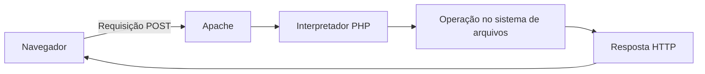

# Arquivos, permissões e redirecionamento em PHP

> **Status:** publicado.
>
> **Título original:** Stealing Facebook Login Using an Identical Fake Login Page
>
> **Escopo:** análise conceitual em laboratório próprio. O coletor de credenciais demonstrado pelo instrutor não é reproduzido; o exemplo seguro registra somente a ocorrência de uma simulação, sem copiar valores enviados.

O que muda quando uma requisição passa a produzir efeitos no armazenamento do servidor? A [aula anterior](14-modifying-the-page-to-steal-login-information.md) distinguiu formulário, envio por `POST` e processamento remoto. Agora o foco está nos recursos que um programa PHP pode solicitar ao sistema: abrir um arquivo, escrever, encerrar seu uso e orientar a próxima requisição do navegador.

A finalidade demonstrada no curso era registrar usuário e senha recebidos de uma página clonada. Esse coletor não é reproduzido nem oferecido para publicação aqui. O equivalente seguro conserva as operações de arquivo e a resposta HTTP, mas registra somente um evento fictício. Ele não lê os valores dos campos nem os transmite ou armazena. Assim, estudar o mecanismo não depende de manipular credenciais.

## Da requisição ao programa PHP

O pedido começa no navegador, mas a execução pertence à instância. Ao receber uma requisição dirigida a um recurso `.php`, o Apache precisa de uma integração configurada para encaminhá-la ao interpretador PHP. Apenas ter o arquivo no diretório web não realiza essa integração.

No modelo apresentado, atendimento web e acesso ao sistema de arquivos ocupam momentos distintos:



O resultado enviado ao cliente é a resposta produzida pelo programa. O código-fonte PHP não é entregue para o navegador executar; suas operações e permissões dizem respeito ao ambiente do servidor.

## O que representa `$_POST`

Para compreender o relato do instrutor, é necessário reconhecer `$_POST`. No PHP, ela é uma **superglobal**, variável que o ambiente disponibiliza em diferentes escopos. Sua organização é a de um array associativo: chaves dão acesso a valores que podem ter vindo do corpo de uma requisição de formulário compatível.

A relação com HTML ocorre pelo nome do controle. Um campo participante chamado `student_id` pode corresponder conceitualmente à chave `$_POST["student_id"]`. O nome identifica qual valor está sendo consultado; não comprova quem enviou a informação nem se ela deve ser aceita.

Como a entrada é controlada pelo cliente, o servidor não pode supor que uma chave exista ou que seu conteúdo tenha o formato desejado. O tratamento legítimo exige conferir o método HTTP, verificar a presença dos dados esperados e validá-los de acordo com a finalidade da aplicação. Estar dentro de uma variável do PHP não transforma uma entrada externa em conteúdo confiável.

O instrutor transferiu duas dessas chaves para variáveis e depois as gravou em texto. Como eram credenciais, essa parte do fluxo ficou excluída do exemplo seguro. O evento fixo usado adiante permite examinar a escrita sem depender de nenhum conteúdo submetido.

## Abrindo um arquivo com `fopen`

Antes de escrever, o programa precisa obter acesso ao arquivo. A função `fopen` tenta abri-lo e, quando consegue, devolve um **handle**: uma referência ao recurso aberto que será usada nas operações seguintes. Se não conseguir, devolve `false`. Esse retorno é a primeira evidência que o programa deve consultar, em vez de presumir que o arquivo está disponível.

A maneira de abrir importa tanto quanto o caminho. O segundo argumento de `fopen` escolhe o modo, e os modos examinados produzem estes efeitos:

| Modo | Leitura | Escrita | Cria se não existir | Preserva conteúdo anterior |
|---|---:|---:|---:|---:|
| `w` | Não | Sim | Sim | Não; trunca o arquivo ao abrir |
| `a` | Não | Sim | Sim | Sim; novas escritas vão para o final |
| `a+` | Sim | Sim | Sim | Sim; novas escritas vão para o final |

A descrição de `a+` no curso enfatizou o acréscimo, mas o `+` também habilita leitura. Para a tarefa restrita de acrescentar uma linha, `a` comunica essa intenção sem solicitar leitura. Já `w` exige cuidado especial porque trunca o conteúdo anterior ao abrir; não é equivalente a continuar um histórico existente.

## Montando uma linha de texto

Uma linha de registro pode combinar informações diferentes. Em PHP, o operador `.` faz essa junção, chamada concatenação. Por exemplo, `"evento: " . $tipo` reúne um texto literal e o conteúdo da variável em uma sequência. Essa operação monta a string; ela ainda não a grava no arquivo.

Para separar eventos no arquivo, uma string entre aspas duplas pode conter `\n`. O PHP interpreta essa sequência como um caractere de nova linha dentro do texto. Não se trata de uma tecla pressionada na interface nem de uma gravação automática: a quebra passa a fazer parte da string que uma operação de escrita receberá.

Juntar um valor a um texto fixo não elimina sua origem externa. Se valores de usuário fossem incluídos sem tratamento, poderiam trazer segredos ou caracteres como quebras de linha capazes de aparentar registros adicionais. Isso prejudicaria a leitura dos logs. O exemplo desta aula evita esse problema de escopo usando um rótulo fixo, não campos enviados.

## Escrevendo e fechando o recurso

Com o recurso aberto e o texto pronto, `fwrite` tenta gravar a string por meio do handle. Ela retorna uma quantidade de bytes ou `false` quando falha. O programa deve interpretar esse retorno: uma página sem mensagem de erro não prova que a quantidade pretendida foi efetivamente escrita.

Ao terminar, `fclose` solicita o fechamento do recurso associado ao handle. A operação encerra o uso dessa referência pelo programa e libera o recurso mantido no processo. Pensar em “fechar uma janela” pode aproximar a ideia, mas não descreve o mecanismo real: quem está sendo encerrado é o acesso ao arquivo, não uma interface gráfica.

Se duas requisições tentarem escrever ao mesmo tempo, surge uma questão adicional: coordenação. **Locking** é o bloqueio usado para organizar acessos concorrentes. Sem ele, escritas de processos diferentes podem se misturar. Para esse tipo de escrita simples em PHP, `flock` permite solicitar exclusividade durante a operação; essa solicitação também faz parte das condições que uma aplicação robusta precisa conferir.

## Por que a primeira escrita falhou

A falha de escrita apresentada no curso não contradiz o upload anterior. A transferência SFTP ocorreu como `kali`, enquanto a requisição HTTP era atendida pela identidade do processo web. Em sistemas baseados em Debian, é comum uma conta restrita como `www-data` exercer esse papel. O programa PHP não herda a identidade da sessão de transferência só por estar no mesmo servidor.

Para interpretar a autorização, é necessário separar os participantes e os metadados que o sistema compara:

- **`kali`:** usuário autenticado na sessão SSH ou SFTP;
- **processo do Apache/PHP:** identidade usada para atender a requisição web;
- **proprietário e grupo do diretório:** metadados que participam da decisão de acesso;
- **bits de permissão:** operações permitidas ao proprietário, ao grupo e aos demais usuários.

O sucesso do FileZilla demonstra uma operação permitida à sua conta, não uma permissão concedida ao Apache/PHP. Por isso, uma falha na abertura pede investigação do caminho, da existência da pasta e dos direitos da identidade que executa o serviço. Alterar permissões sem identificar esse processo pode mascarar a causa.

## Por que `777` não é uma correção adequada

A resposta do instrutor foi criar um diretório com permissão `777`. Nessa notação octal, os três dígitos representam proprietário, grupo e demais usuários; cada `7` reúne leitura, escrita e execução. Em diretórios, essas capacidades participam da listagem, da criação ou remoção de entradas e da travessia do caminho, respeitadas as outras condições do sistema.

O problema dessa escolha é conceder escrita amplamente para contornar uma necessidade específica. Em uma aplicação real, isso amplia o que uma conta ou processo comprometido poderia modificar. O fato de a mensagem de erro desaparecer não torna a autorização adequada.

O critério apropriado é o de **menor privilégio**: dar a cada componente apenas o acesso necessário à tarefa. Para este caso, isso significa:

- o processo recebe escrita somente no local realmente necessário;
- o diretório de log fica fora do document root, para não ser baixado por HTTP;
- proprietário e grupo representam as identidades que administram e usam o recurso;
- as permissões não concedem escrita a todos os usuários;
- segredos nunca são registrados em texto puro.

Não existe um único número que substitua a análise. Proprietário, grupo, umask e arquitetura da aplicação influenciam a decisão. Copiar `777` ignora essas relações e transforma uma recusa localizada em uma concessão excessiva.

## Redirecionando depois de um `POST`

Gravar um evento e escolher a próxima tela são saídas diferentes. No PHP, `header` acrescenta um cabeçalho à resposta HTTP; com `Location`, informa ao navegador outra URL a solicitar. O servidor responde com uma orientação, e o cliente realiza uma nova requisição.

A ordem da resposta impõe um limite: os cabeçalhos devem ser definidos antes do envio do corpo. Se espaços, HTML ou mensagens de erro já tiverem sido enviados, a tentativa posterior pode produzir **headers already sent**. Esse aviso trata da resposta em construção, não das permissões do arquivo de log.

Uma aplicação legítima pode concluir um `POST` com `303 See Other`, orientando a busca da página seguinte por `GET`. Isso evita que a atualização dessa página repita o corpo do formulário anterior. Depois de definir a orientação, `exit` encerra o script: enviar um cabeçalho de redirecionamento não é, por si só, uma instrução para parar toda execução restante.

O curso usou um destino externo para disfarçar a coleta. Esse propósito não integra o exercício seguro. Aqui a resposta aponta a uma página local de conclusão, identificada como simulação, mantendo explícito ao participante o contexto da atividade.

## Um equivalente seguro para o laboratório

O trecho preservado abaixo permite reconhecer abertura, append, bloqueio, escrita, fechamento e resposta de redirecionamento sem consultar `$_POST`. A única linha acrescentada combina horário com um rótulo constante de simulação. Nenhum valor fornecido pelo visitante entra nessa composição.

O caminho ilustrativo fica fora do diretório publicado e não deve ser confundido com um recurso pronto. O administrador ainda precisaria preparar a pasta e conceder ao processo web somente as permissões necessárias. O exemplo não instala essa configuração nem comprova sua existência no laboratório.

```php
<?php

declare(strict_types=1);

if ($_SERVER["REQUEST_METHOD"] !== "POST") {
    http_response_code(405);
    exit;
}

$logPath = "/var/log/training-app/events.log";
$handle = fopen($logPath, "a");

if ($handle === false) {
    http_response_code(500);
    exit;
}

flock($handle, LOCK_EX);
$written = fwrite(
    $handle,
    gmdate(DATE_ATOM) . " simulated_submission\n"
);
flock($handle, LOCK_UN);
fclose($handle);

if ($written === false) {
    http_response_code(500);
    exit;
}

header("Location: /training-complete.html", true, 303);
exit;
```

A declaração `declare(strict_types=1)` torna determinadas conversões de tipos mais estritas no PHP; ela não valida automaticamente entradas externas. O primeiro desvio do programa verifica o método: se não for `POST`, a resposta é `405 Method Not Allowed` e a execução termina.

Na sequência, `fopen` solicita abertura em append, e a comparação com `false` separa recurso obtido de falha. O código pede exclusividade com `flock`, tenta acrescentar o evento com `fwrite`, libera o bloqueio e fecha o handle com `fclose`. Se a escrita retornar `false`, responde com erro `500`; caso contrário, define `Location` local com `303` e encerra por `exit`. Como exemplo didático, ele não confere todos os retornos: o bloqueio pode falhar e uma escrita parcial exige comparação adicional da quantidade de bytes. Não deve ser tratado como implementação completa de produção.

Mesmo sem registrar campos, o trecho depende do ambiente. A pasta deve existir, ficar fora do atendimento web e possuir autorização mínima adequada; a página `/training-complete.html` precisa estar disponível no próprio laboratório. Ver um redirecionamento não demonstra, sozinho, todas essas condições nem transforma o exemplo em um ambiente automaticamente seguro.

## O que a captura do laboratório demonstra

A captura fornecida para esta aula mostrava pares de texto semelhantes a credenciais. Como incluía endereços e valores confundíveis com dados reais, não foi incorporada ao livro. O registro público deve preservar a explicação da evidência sem expor os possíveis segredos; sanitizar o material é condição anterior à publicação.

Uma linha visível no arquivo sustenta apenas que houve alguma escrita. Essa observação, isoladamente, não permite concluir:

- que todos os bytes foram gravados sem concorrência;
- que o arquivo está protegido contra download por HTTP;
- que as permissões seguem menor privilégio;
- que dados sensíveis foram tratados legalmente;
- que o redirecionamento posterior possui finalidade legítima.

Se uma senha verdadeira tiver participado do teste, trate-a como exposta mesmo que o arquivo não tenha sido publicado. É necessário alterá-la no serviço correspondente, encerrar sessões ativas e retirar as cópias do servidor e do computador local. Apagar uma linha não desfaz o acesso que o segredo já possa ter permitido.

## Encerrando o laboratório

O encerramento inclui retirar o endpoint de teste, eventual arquivo com dados submetidos e qualquer cópia visual de marca. O conteúdo público pode ser substituído por uma página neutra de conscientização; a porta `80` deve ser restringida ou a instância encerrada quando perder sua função. Confira também os custos que permanecem na conta de nuvem.

A relação essencial é entre requisição, identidade do processo e efeito no sistema. O programa não age com os direitos de quem fez o upload: usa os direitos de sua execução no servidor. Abrir um recurso, escrever bytes e definir uma resposta são capacidades distintas, cada uma com falhas observáveis e limites próprios. Entendê-las permite interpretar o relato do curso sem transformar o estudo em armazenamento de senhas.