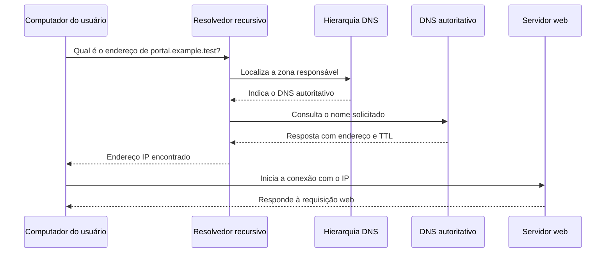

# Do nome de domínio ao endereço IP

> **Status:** publicado.
>
> **Título original:** Domain Name and DNS Basics
>
> **Escopo:** fundamentos de domínio e DNS aplicados somente a infraestrutura própria ou a um laboratório autorizado. O uso de nomes que imitam marcas ou induzem terceiros ao erro não faz parte do exercício.

Na [aula anterior](15-stealing-facebook-login-using-an-identical-fake-login-page.md), o navegador acessou o servidor web diretamente pelo endereço IP público. Isso permitiu alcançar a página, mas não explicou como nomes como `example.com` conduzem o navegador até um servidor nem o que os indicadores de segurança do navegador realmente significam.

Esta aula parte dessa diferença: pessoas costumam lembrar nomes, enquanto a comunicação IP precisa de endereços. O **Domain Name System (DNS)** fornece os dados que relacionam esses dois identificadores.

## IP, domínio e URL identificam coisas diferentes

Um **endereço IP** identifica uma interface alcançável em uma rede IP. Um **nome de domínio** é um nome hierárquico administrado no DNS. Uma **URL**, por sua vez, informa como e onde acessar um recurso; ela pode incluir esquema, host, porta e caminho.

Considere este endereço reservado para documentação:

```text
https://portal.example.test/login
```

Nele, `https` é o esquema, `portal.example.test` é o host e `/login` é o caminho. O host é formado por rótulos separados por pontos: `test` ocupa a posição de **Top-Level Domain (TLD)**, `example` está abaixo dele e `portal` é outro nível, frequentemente chamado de subdomínio.

O sufixo `.test` é reservado para testes e não deve ser esperado no DNS público. Em um laboratório que precise de resolução pública, deve-se usar um domínio neutro realmente controlado pelo estudante, sem referência enganosa a pessoas, empresas ou serviços de terceiros.

## Como o navegador encontra o servidor

Ao receber uma URL com um nome de domínio, o navegador precisa descobrir um endereço IP antes de iniciar a conexão com o servidor. Em uma explicação simples, ele consulta o DNS e recebe o endereço. Tecnicamente, há mais componentes no caminho.

O navegador e o sistema operacional verificam primeiro se ainda possuem uma resposta válida em cache. Se não houver, o computador consulta um **resolvedor recursivo**, normalmente fornecido pela rede local, pelo provedor de Internet ou por um serviço configurado pelo usuário. Esse resolvedor procura a resposta em nome do cliente.

Quando também não possui a informação em cache, o resolvedor percorre a hierarquia do DNS. Servidores raiz indicam quais servidores conhecem o TLD; os servidores do TLD indicam quais são autoritativos para o domínio; por fim, um **servidor autoritativo** responde com os registros publicados para aquele nome.



Um registro **A** associa um nome a um endereço IPv4; um registro **AAAA** faz a associação com IPv6. A resposta inclui um **Time to Live (TTL)**, período durante o qual ela pode permanecer em cache. Por isso, uma mudança de DNS pode não aparecer simultaneamente para todos: respostas antigas ainda podem ser usadas até seus respectivos tempos expirarem.

DNS não cria uma conexão com o site e não transporta a página. Ele fornece dados para que o cliente encontre um endereço. Depois da resolução, o navegador ainda precisa abrir uma conexão de transporte, normalmente TCP para o HTTP estudado neste módulo, alcançar uma porta permitida e conversar com um processo de servidor web que esteja em execução.

## O mesmo IP pode hospedar vários nomes

Obter o IP não encerra a identificação do destino. Vários sites podem compartilhar um único endereço. Na requisição HTTP, o navegador informa o nome desejado no cabeçalho `Host`; em uma conexão HTTPS, o nome também participa da negociação TLS. Com essa informação, o servidor pode selecionar a configuração e o conteúdo correspondentes.

Isso explica por que apenas apontar um nome para um IP não garante que a página correta aparecerá. O servidor web precisa estar configurado para reconhecer aquele host. Também é necessário que o serviço esteja iniciado e que os firewalls do sistema e da nuvem permitam a porta usada. Cada condição controla uma parte diferente do fluxo.

## Registro e publicação no DNS não são a mesma ação

Um **registrador de domínios** é uma organização por meio da qual uma pessoa registra o direito de uso de um nome por um período. O **registro** mantém a base do TLD, enquanto o **registrante** é quem detém aquele direito de uso. O serviço que hospeda a zona DNS pode ser oferecido pelo próprio registrador ou por outro provedor.

Nomes precisam ser únicos dentro do mesmo espaço hierárquico enquanto estiverem registrados. Isso não significa comprar o nome para sempre: registros possuem prazo, renovação e condições contratuais. Preço inicial, preço de renovação, impostos e serviços adicionais também podem ser diferentes.

Concluir o pagamento apenas registra o domínio. Para que um host conduza ao laboratório, ainda será necessário publicar o registro DNS adequado, aguardar a atualização dos caches e configurar o servidor que receberá a conexão. Essa configuração será acompanhada na aula seguinte.

Serviços de privacidade de registro podem ocultar parte dos dados pessoais exibidos publicamente em consultas de registro. Eles não tornam o proprietário anônimo perante registrador, meios de pagamento ou autoridades competentes, nem substituem a remoção de dados privados das páginas e dos registros do laboratório.

## O que os avisos do navegador realmente informam

A aula relacionou o uso de um IP e a ausência de HTTPS a indicadores visuais de perigo. Esses sinais precisam ser interpretados separadamente.

Uma página HTTP não protege o tráfego com TLS. O navegador pode marcá-la como **não segura** porque conteúdo e dados enviados podem ser observados ou alterados no caminho. Já uma tela vermelha que denuncia conteúdo enganoso ou perigoso pode vir de mecanismos de reputação, como listas de navegação segura. Trocar o IP por um domínio ou habilitar HTTPS não remove legitimamente esse tipo de alerta.

HTTPS autentica o domínio apresentado pelo servidor conforme as regras do certificado, protege a integridade do tráfego e o cifra durante o transporte. Ele não prova que o conteúdo é honesto, que a empresa exibida é verdadeira ou que a página merece confiança. Um site malicioso também pode possuir um certificado válido. Por isso, o cadeado não deve ser usado como sinônimo de legitimidade.

## Limite ético do laboratório

O instrutor sugeriu registrar variações de nomes conhecidos para aumentar a semelhança com uma página de terceiros. Essa prática é associada a **typosquatting** e impersonação: nomes visualmente ou linguisticamente próximos são usados para explorar erros e confiança do usuário. Contra terceiros, isso pode causar fraude, violar marcas e produzir consequências legais.

Em um exercício autorizado, use um nome neutro sob seu controle, uma página claramente identificada como simulação e contas fictícias. Não publique cópias de marcas nem colete credenciais. O objetivo técnico desta sequência é observar resolução DNS, configuração do servidor e proteção do transporte, não tornar uma fraude mais convincente.

Ao terminar, remova registros que não serão mais usados, encerre serviços expostos, revise regras de entrada da nuvem e verifique renovação automática e custos do domínio. Se o IP público da instância mudar, um registro que ainda aponta para o endereço antigo deixa de conduzir ao laboratório e precisa ser removido ou atualizado.

O aprendizado central é que domínio, DNS e servidor web possuem responsabilidades distintas. O domínio fornece um nome administrável; o DNS publica informações que permitem encontrar um endereço; a rede leva a conexão até esse endereço; e o processo servidor decide como responder ao nome solicitado. Nenhuma dessas etapas, isoladamente, comprova que um site é legítimo ou seguro.