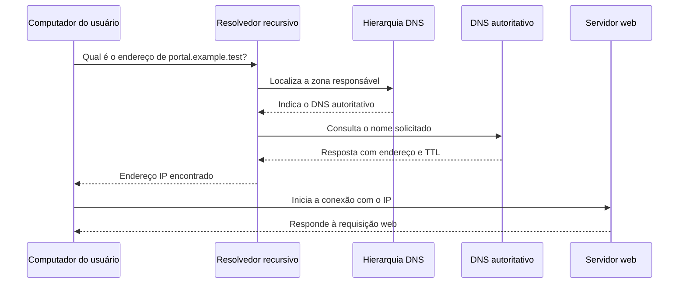

# Do nome de domínio ao endereço IP

> **Status:** publicado.
>
> **Título original:** Domain Name and DNS Basics
>
> **Escopo:** fundamentos de domínio e DNS aplicados somente a infraestrutura própria ou a um laboratório autorizado. O uso de nomes que imitam marcas ou induzem terceiros ao erro não faz parte do exercício.

Como o navegador chega a uma máquina quando recebe um nome em vez de um número? O acesso pelo IP público, usado na [aula anterior](15-stealing-facebook-login-using-an-identical-fake-login-page.md), permite chegar ao servidor sem resolver essa pergunta. Ao introduzir um nome como `example.com`, precisamos entender quem fornece o endereço correspondente e por que essa associação não comprova a segurança da página.

Nomes são convenientes para pessoas e administração; pacotes IP, porém, seguem endereços na rede. O **Domain Name System (DNS)** mantém informações distribuídas que permitem relacionar esses identificadores. Ele participa da descoberta do destino, não substitui a conexão que transportará o conteúdo web.

## IP, domínio e URL identificam coisas diferentes

Antes de acompanhar a consulta, separe três objetos. Um **endereço IP** identifica uma interface em uma rede IP, cujo alcance depende da rede. Um **nome de domínio** organiza um nome dentro da hierarquia administrada pelo DNS. Já uma **URL** descreve o acesso a um recurso, podendo reunir esquema, host, porta e caminho. Assim, o domínio pode integrar a URL sem ser a URL inteira.

O endereço a seguir usa um nome reservado para documentação e permite reconhecer essas partes sem apontar para uma aplicação real:

```text
https://portal.example.test/login
```

Lendo da esquerda para a direita, `https` define o esquema, `portal.example.test` nomeia o host e `/login` escolhe o caminho do recurso. Dentro do host, os pontos separam rótulos da hierarquia. `test` ocupa a posição de **Top-Level Domain (TLD)**; abaixo dele está `example`, seguido por `portal`, nível que costumamos chamar de subdomínio.

Esse exemplo não é uma promessa de resolução na Internet: `.test` é reservado para testes. Se o exercício depender de DNS público, deverá usar um domínio neutro realmente controlado pelo estudante. Imitar uma pessoa, empresa ou serviço não é requisito para aprender resolução e não faz parte do laboratório.

## Como o navegador encontra o servidor

Ao abrir uma URL cujo host é um nome, o navegador precisa obter um endereço antes de se conectar ao servidor. Dizer apenas “consulta o DNS” esconde quem responde e de onde vem a informação. A resposta pode já estar armazenada perto do cliente ou exigir uma procura pela hierarquia.

O primeiro atalho é o cache, uma resposta guardada que ainda pode ser usada pelo navegador ou sistema operacional. Quando não há informação válida ali, o computador recorre a um **resolvedor recursivo**. Ele pode ser fornecido pela rede, pelo provedor de Internet ou por uma configuração do usuário. Seu papel é procurar a resposta em nome do cliente, evitando que o próprio navegador percorra cada nível.

Se o resolvedor também não dispõe de cache suficiente, a hierarquia fornece as referências. A raiz indica os servidores do TLD, e estes indicam os responsáveis pelo domínio. Ao final, um **servidor autoritativo** fornece os registros publicados na zona pela qual responde. “Autoritativo” descreve essa responsabilidade pelos dados, não um selo de honestidade do site associado.



Os dados de endereço podem aparecer em um registro **A**, para IPv4, ou **AAAA**, para IPv6. Cada resposta tem um **Time to Live (TTL)**, que limita por quanto tempo pode permanecer em cache. Se a publicação mudar enquanto uma resposta antiga ainda é válida, clientes diferentes podem receber informações diferentes. Isso explica a diferença de tempo percebida sem supor que todos os computadores tenham consultado a fonte novamente.

Depois de descobrir o endereço, o trabalho do DNS nessa descoberta não deve ser confundido com o atendimento web. A página seguirá por outra comunicação. No HTTP estudado neste módulo, o navegador normalmente abre TCP, alcança a porta do serviço e conversa com um processo web ativo. Uma resposta DNS correta pode coexistir com uma porta bloqueada ou um Apache parado, porque são condições independentes.

## O mesmo IP pode hospedar vários nomes

O endereço encontrado nem sempre identifica um único site. Um mesmo IP pode atender vários nomes, e o servidor precisa reconhecer qual deles foi solicitado. No HTTP, o cabeçalho `Host` leva esse nome; no HTTPS, ele também participa da negociação TLS. Essas informações permitem selecionar a configuração e o conteúdo adequados entre sites que compartilham a infraestrutura.

Portanto, apontar o nome ao IP é apenas uma parte da configuração. O servidor deve reconhecer o host, o serviço precisa estar iniciado e os controles de tráfego locais e da nuvem devem permitir a porta escolhida. Se aparecer uma página inesperada, é necessário examinar também a seleção do site no servidor, em vez de atribuir automaticamente o problema ao DNS.

## Registro e publicação no DNS não são a mesma ação

O nome administrável envolve papéis diferentes. O **registrante** detém o direito de uso; o **registrador de domínios** é a organização pela qual esse direito é registrado por um período; o **registro** mantém a base do TLD. A zona DNS pode ser hospedada pelo registrador ou por outro provedor. Por isso, a empresa que recebe o pagamento pelo nome não precisa ser a mesma que publica seus registros DNS.

Dentro do mesmo espaço hierárquico, o nome registrado precisa ser único durante a vigência do registro. Essa exclusividade tem prazo e condições contratuais; não equivale a uma compra permanente. Ao planejar o laboratório, diferencie preço inicial, renovação, impostos e serviços adicionais, pois um valor promocional não descreve necessariamente o custo futuro.

Pagar pelo domínio não escolhe automaticamente a máquina que responderá por cada host. Ainda é preciso publicar dados DNS adequados, considerar os caches existentes e preparar o servidor para receber o nome. A próxima aula acompanha essa passagem do direito de uso para a configuração técnica observável.

Alguns serviços de privacidade reduzem a exposição pública de dados pessoais nas consultas de registro. Seu limite deve ficar claro: não produzem anonimato perante registrador, meios de pagamento ou autoridades competentes. Também não retiram informações privadas que o estudante publique por conta própria em páginas, capturas e registros do laboratório.

## O que os avisos do navegador realmente informam

O curso aproximou o acesso por IP, a ausência de HTTPS e os indicadores de perigo do navegador. Para interpretar a evidência corretamente, é preciso desfazer essa associação automática: os avisos não têm todos a mesma origem nem significam a mesma coisa.

O aviso **não segura** pode informar que a comunicação HTTP não usa TLS, deixando conteúdo e dados sujeitos a observação ou alteração no caminho. Uma tela que denuncia site enganoso ou perigoso pode, por outro lado, vir de mecanismos de reputação e listas de navegação segura. Mudar de IP para nome ou instalar HTTPS não constitui correção legítima de conteúdo classificado como perigoso.

HTTPS protege a integridade e a confidencialidade do transporte e permite verificar o domínio apresentado segundo as regras do certificado. O que ele não verifica é a honestidade do texto, a identidade da empresa imitada ou a finalidade da solicitação feita ao visitante. Um certificado válido pode estar em um site malicioso. Logo, o indicador da conexão não deve ser lido como aprovação do conteúdo.

## Limite ético do laboratório

Na demonstração, houve a sugestão de escolher variações de nomes conhecidos para reforçar a semelhança com terceiros. Essa conduta se relaciona a **typosquatting** e impersonação: a proximidade visual ou linguística explora erros e confiança das pessoas. Não é uma condição técnica do DNS. Seu uso contra terceiros pode resultar em fraude, violação de marcas e consequências legais.

O exercício autorizado segue um limite diferente: nome neutro sob controle do estudante, identificação clara de simulação e contas fictícias. Cópias públicas de marcas e coleta de credenciais ficam excluídas. O que deve ser observado é a relação entre resolução, configuração web e transporte protegido; tornar a página mais convincente para enganar alguém não faz parte da verificação.

Ao encerrar a atividade, retire os registros sem uso e os serviços expostos, revise a entrada na nuvem e confira renovação automática e custos do domínio. Esse cuidado também vale quando o IP público muda: um apontamento antigo já não representa a instância atual e precisa ser atualizado ou removido, em vez de continuar anunciado como destino do laboratório.

A sequência fica compreensível quando cada componente responde à sua própria pergunta. O domínio fornece um nome administrável; o DNS informa onde procurá-lo; a rede permite ou impede alcançar o endereço; o processo web escolhe a resposta ao host solicitado. Verificar uma dessas partes não valida automaticamente as outras, e nenhuma delas isolada comprova legitimidade ou segurança do site.