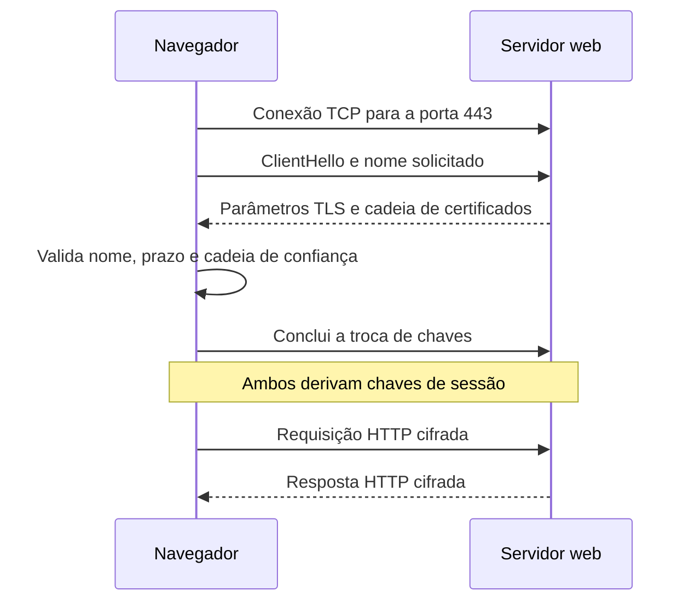

# O que o HTTPS protege

> **Status:** publicado.
>
> **Título original:** Introduction to HTTPS
>
> **Escopo:** fundamentos de HTTPS e TLS aplicados a um domínio e servidor próprios. Um certificado válido protege o transporte até o domínio apresentado; ele não torna legítima uma página criada para imitar terceiros.

Encontrar o servidor certo não impede que as mensagens sejam observadas no caminho. A [aula anterior](17-linking-domain-names-to-phishing-pages.md) tratou do DNS que fornece o IPv4 público da instância; o acesso web continuava por HTTP. Agora precisamos entender o que protege uma requisição entre o momento em que sai do navegador e sua chegada ao servidor, e o que essa proteção deixa de fora.

Essa camada de proteção é **Transport Layer Security (TLS)**. Quando HTTP é transportado por uma conexão protegida por TLS, chamamos o conjunto de **HTTPS**. O conteúdo continua sendo uma conversa HTTP de requisições e respostas; muda a forma como essa conversa é protegida durante o transporte.

## Três propriedades do transporte protegido

Sem TLS, quem tiver condições de observar ou interferir no caminho de rede poderá ler mensagens HTTP, capturar dados e modificar conteúdo. Escolher `POST` não elimina essa possibilidade. O método descreve a forma e a finalidade do pedido, mas não fornece um mecanismo criptográfico para proteger o que atravessa a rede.

Para responder a esse problema, TLS combina três propriedades do transporte, que precisam ser compreendidas separadamente:

- **confidencialidade:** o conteúdo da comunicação é cifrado para que não seja compreendido apenas pela captura dos pacotes;
- **integridade:** alterações feitas no tráfego podem ser detectadas, em vez de serem aceitas silenciosamente;
- **autenticação do servidor:** o cliente verifica se o certificado apresentado é válido para o nome solicitado e se conduz a uma autoridade certificadora confiável.

As três garantias dizem respeito à comunicação, não à conduta das aplicações nas pontas. Depois de decifrar uma requisição, o servidor pode tratá-la corretamente ou armazenar dados de maneira insegura. HTTPS não corrige essa decisão, não comprova honestidade do conteúdo e não remove malware do cliente ou do servidor. Proteger o trajeto não equivale a proteger tudo o que acontece depois da chegada.

Há também informações que não desaparecem com a cifragem do conteúdo. Endereços IP e quantidade aproximada de dados transferidos podem continuar observáveis. A comunicação fica protegida em aspectos específicos, não invisível para todos os participantes da rede.

## Do TCP ao HTTP protegido

No fluxo tradicional deste módulo, primeiro o navegador resolve o nome e abre TCP para a porta `443` do servidor. Porta é um identificador lógico de `0` a `65535`, não uma entrada física. A conexão precisa chegar ao processo que atende esse identificador. Permitir `443` no Security Group não inicia o Apache, assim como iniciar o Apache não libera automaticamente a regra de entrada na nuvem.

Antes de enviar HTTP por essa conexão, os dois lados realizam o **handshake TLS**. Essa negociação inicial escolhe parâmetros de segurança, permite verificar a identidade apresentada e estabelece os segredos dos quais serão derivadas as chaves de sessão. Só depois vem a troca de mensagens HTTP protegidas.

A negociação começa com o cliente anunciando versões e algoritmos que aceita. O servidor seleciona parâmetros, fornece a cadeia de certificados e demonstra controle da chave privada correspondente. O navegador não deve aceitar apenas a existência de um certificado: verifica o nome da URL, o período de validade e as assinaturas que conduzem a uma raiz confiável. São essas relações que sustentam a autenticação do servidor.

Em protocolos TLS modernos, não é a chave pública do certificado que cifra diretamente cada página ou imagem transmitida. A criptografia assimétrica participa da autenticação e do estabelecimento seguro de segredos no handshake. Desses segredos, cliente e servidor derivam chaves simétricas temporárias, adequadas à proteção eficiente dos dados da sessão. Separar esses papéis evita imaginar que um certificado seja um recipiente para todo o tráfego.

## Certificado e chave privada cumprem papéis diferentes

O certificado TLS pode ser entendido como um documento digital assinado que relaciona uma chave pública a um ou mais nomes. Ele inclui esses nomes, o emissor, a validade e a própria chave pública. O servidor o apresenta no handshake para que o navegador consiga examinar essa associação e a cadeia que a sustenta.

A **chave privada** é a contraparte secreta que deve permanecer sob controle do servidor. Ela permite demonstrar posse da identidade criptográfica associada ao certificado. Se for copiada por terceiros, poderá apoiar tentativas de se passar pelo servidor enquanto o certificado for aceito. Por isso, publicar o certificado e publicar a chave são situações completamente diferentes: a chave nunca deve aparecer em repositórios, diretórios web, capturas ou notas.

Isso não significa que a chave privada atual seja uma chave universal para decifrar todo o histórico. As mensagens são protegidas pelas chaves de sessão derivadas na negociação. Com trocas efêmeras, obter futuramente a chave privada do certificado não basta, por si só, para recuperar sessões antigas capturadas. Essa propriedade, chamada **forward secrecy**, limita o efeito de um comprometimento posterior, sem tornar aceitável expor a chave.

## De onde vem a confiança no certificado

A assinatura vem de uma **Certificate Authority (CA)**, ou autoridade certificadora, segundo regras reconhecidas pelos clientes. Navegador ou sistema operacional mantém raízes confiáveis. O servidor normalmente fornece seu certificado e os intermediários necessários para construir o caminho até uma dessas raízes. Portanto, a confiança não nasce de um texto dizendo “certificado válido”, mas de verificações sobre essa cadeia.

Um exemplo de autoridade pública e sem fins lucrativos é a [Let's Encrypt](https://letsencrypt.org/). Ela oferece certificados gratuitos após um desafio automatizado de controle do domínio. O alcance dessa evidência é técnico: o solicitante demonstrou controlar o nome nas condições do desafio. Isso não comprova vínculo com a organização que uma página exibe ou imita.

A automação usa o protocolo **Automatic Certificate Management Environment (ACME)**. Um de seus clientes é o **Certbot**, programa capaz de pedir certificados, atender ao desafio e, com o plugin adequado, configurar o Apache. Assim, Let's Encrypt é a entidade emissora, ACME define a conversa automatizada e Certbot é quem a conduz do lado do administrador. Confundir esses componentes dificulta localizar uma falha de emissão ou instalação.

## O indicador do navegador não é um selo de honestidade

O ícone que representa a conexão pode mudar entre versões de navegador. O cadeado destacado em interfaces antigas pode dar lugar a controles do site em outras versões. A leitura técnica permanece: a comunicação foi protegida para o host exibido e o certificado passou pelas verificações daquele cliente. O desenho não acrescenta uma avaliação moral da página.

Um fraudador que controla um domínio também pode conseguir certificado válido para ele. Nesse cenário, TLS protege a conversa com a infraestrutura fraudulenta, exatamente como foi solicitado ao abrir aquele host. Conferir o domínio completo, a finalidade da página e o contexto da solicitação continua necessário; o transporte protegido não toma essa decisão pelo usuário.

Já a indicação de **site enganoso** pode vir de serviços de reputação e navegação segura. Ela trata de risco de conteúdo ou infraestrutura, não simplesmente da ausência de TLS. Instalar certificado não é uma forma legítima de contornar essa classificação, e os dois tipos de alerta devem ser interpretados separadamente.

## Condições para a próxima etapa

Para avançar à emissão no laboratório, é necessário que o nome resolva publicamente para a instância correta, que o Apache reconheça o host e que a autoridade consiga alcançar o desafio exigido. Ver o site abrir localmente não prova essas condições externas. Um DNS apontando para outro IP ou uma filtragem que impeça a validação pode fazer o pedido falhar mesmo com uma página visível no computador do estudante.

Depois de instalar, a evidência deve incluir conexão em `443`, nomes corretos no certificado, cadeia aceita e teste de renovação. A [próxima aula](19-enabling-https-on-phishing-pages.md) relaciona essas verificações à Let's Encrypt, ao Certbot, ao Apache e aos controles da nuvem. A mensagem de instalação concluída é um estado intermediário, não a comprovação de todo o ciclo.

A conclusão deve conservar esse limite: HTTPS protege a comunicação com o domínio que o cliente decidiu acessar. Ele não torna a página “100% legítima” nem substitui a análise do conteúdo. Entender o que foi autenticado e o que foi cifrado é justamente o que impede transformar uma proteção real em uma promessa que ela não faz.