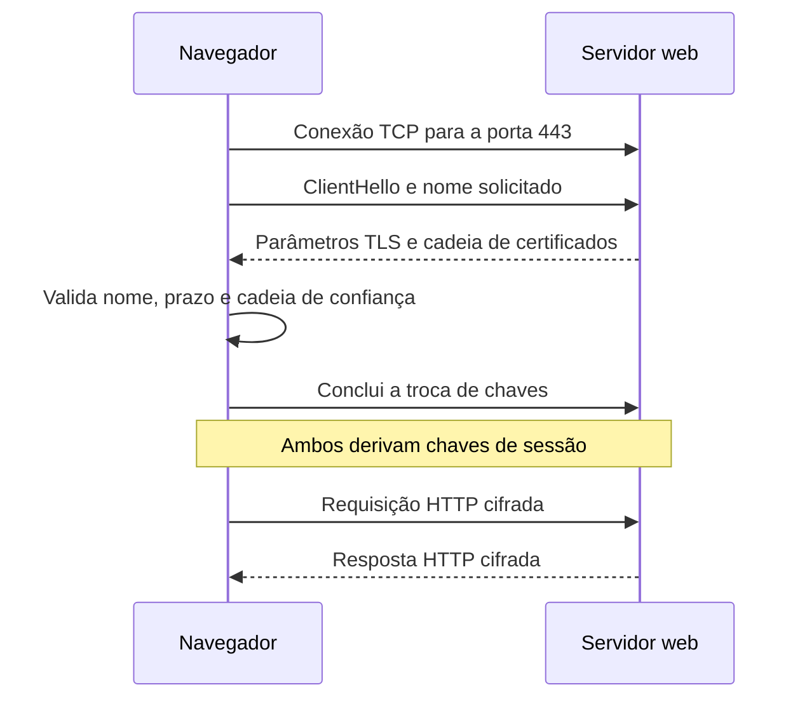

# O que o HTTPS protege

> **Status:** publicado.
>
> **Título original:** Introduction to HTTPS
>
> **Escopo:** fundamentos de HTTPS e TLS aplicados a um domínio e servidor próprios. Um certificado válido protege o transporte até o domínio apresentado; ele não torna legítima uma página criada para imitar terceiros.

Na [aula anterior](17-linking-domain-names-to-phishing-pages.md), o DNS passou a fornecer o IPv4 público do servidor quando o domínio do laboratório era consultado. A página, porém, ainda era acessada por HTTP. Nesta aula, a pergunta muda: como navegador e servidor protegem as mensagens contra leitura e alteração durante o trânsito?

A resposta é **HTTPS**, o uso do protocolo HTTP dentro de uma conexão protegida por **Transport Layer Security (TLS)**.

## Três propriedades do transporte protegido

Em HTTP sem TLS, um participante que consiga observar ou modificar o caminho de rede pode ler requisições e respostas, alterar conteúdo ou capturar dados enviados. O método `POST` não resolve esse problema: ele muda a forma e a finalidade da requisição, não fornece criptografia.

TLS acrescenta três propriedades principais ao transporte:

- **confidencialidade:** o conteúdo da comunicação é cifrado para que não seja compreendido apenas pela captura dos pacotes;
- **integridade:** alterações feitas no tráfego podem ser detectadas, em vez de serem aceitas silenciosamente;
- **autenticação do servidor:** o cliente verifica se o certificado apresentado é válido para o nome solicitado e se conduz a uma autoridade certificadora confiável.

Essas garantias têm limites. HTTPS não confirma que o conteúdo é honesto, não impede que a própria aplicação armazene dados de forma insegura e não remove malware do servidor ou do cliente. Depois que a aplicação recebe e decifra a requisição, ela ainda precisa tratar os dados com segurança.

Alguns metadados de rede também continuam observáveis, como os endereços IP e a quantidade aproximada de dados transferidos. Portanto, criptografar o conteúdo não torna a comunicação invisível.

## Do TCP ao HTTP protegido

No fluxo tradicional estudado aqui, o navegador resolve o domínio e abre uma conexão TCP com a porta `443` do servidor. A porta é um identificador lógico usado para entregar a conexão ao processo correto; liberar `443` no Security Group não inicia o Apache, e iniciar o Apache não abre sozinho o caminho na nuvem.

Antes de transmitir a requisição HTTP, cliente e servidor executam o **handshake TLS**, uma negociação que define os parâmetros de segurança e estabelece chaves de sessão.

O cliente anuncia versões e algoritmos compatíveis. O servidor escolhe parâmetros, apresenta sua cadeia de certificados e prova que controla a chave privada correspondente. O navegador verifica, entre outros pontos, se o nome da URL aparece no certificado, se o período de validade inclui a data atual e se as assinaturas formam uma cadeia até uma raiz confiável.

Em TLS moderno, a chave pública do certificado não é usada para cifrar diretamente todas as páginas, imagens e senhas. O handshake emprega criptografia assimétrica para autenticação e estabelecimento seguro de segredos; a partir deles, cliente e servidor derivam chaves simétricas temporárias para proteger os dados da sessão com eficiência.

## Certificado e chave privada cumprem papéis diferentes

Um certificado TLS é um documento digital que associa uma chave pública a um ou mais nomes. Entre seus campos estão os nomes válidos, o emissor, o período de validade e a chave pública. O navegador recebe esse certificado durante o handshake.

A **chave privada** correspondente permanece sob controle do servidor. Ela permite provar a posse da identidade criptográfica apresentada no certificado. Se essa chave for copiada por terceiros, eles podem tentar se passar pelo servidor enquanto o certificado for aceito; por isso, ela não deve ser enviada a repositórios, diretórios web, capturas ou notas.

A chave privada não é a única capaz de “decifrar todo o tráfego” em protocolos atuais. As chaves de sessão derivadas no handshake protegem os dados. Com mecanismos de troca efêmera, comprometer a chave privada no futuro não basta, por si só, para recuperar sessões antigas que foram capturadas; essa propriedade é chamada **forward secrecy**.

## De onde vem a confiança no certificado

Uma **Certificate Authority (CA)**, ou autoridade certificadora, assina certificados segundo regras que os navegadores reconhecem. O sistema ou navegador mantém um conjunto de raízes confiáveis. O servidor normalmente envia seu certificado e os certificados intermediários necessários para construir a cadeia até uma dessas raízes.

A [Let's Encrypt](https://letsencrypt.org/) é uma autoridade certificadora pública e sem fins lucrativos. Ela emite certificados gratuitos após validar, por um desafio automatizado, que o solicitante controla o domínio. Essa validação não comprova que o solicitante representa a organização sugerida pelo texto ou pela aparência da página.

O **Certbot** é um cliente do protocolo **Automatic Certificate Management Environment (ACME)**. Ele pode solicitar o certificado, responder ao desafio de controle do domínio e, com o plugin apropriado, ajustar a configuração do Apache. Let's Encrypt é a entidade que emite; ACME é o protocolo de automação; Certbot é um programa cliente. Esses nomes não representam o mesmo componente.

## O indicador do navegador não é um selo de honestidade

Interfaces de navegadores mudam com o tempo. Algumas versões mostravam um cadeado com grande destaque; versões atuais podem usar outro ícone de controles do site. O significado técnico não deve depender do desenho: a conexão foi protegida para o host exibido e o certificado passou pelas verificações do navegador.

Um domínio controlado por um fraudador também pode obter um certificado válido. Nesse caso, o TLS protege precisamente a conexão entre a vítima e a infraestrutura fraudulenta. Por isso, o usuário ainda precisa conferir o domínio completo, a finalidade da página e o contexto da solicitação.

Da mesma forma, um aviso de **site enganoso** pode vir de serviços de reputação e navegação segura. Esse alerta é diferente do aviso de conexão HTTP. Instalar um certificado não deve ser tratado como forma de contornar uma classificação de conteúdo perigoso.

## Condições para a próxima etapa

Antes de solicitar um certificado no laboratório, o domínio precisa resolver publicamente para o servidor correto, o Apache deve responder ao nome e os desafios exigidos pela autoridade certificadora precisam alcançar a máquina. A emissão pode falhar mesmo quando o site abre localmente, por exemplo, se o DNS ainda aponta para outro IP ou se o firewall bloqueia a validação.

A instalação também precisa ser acompanhada por uma verificação real: conexão na porta `443`, certificado emitido para o host correto, cadeia aceita e renovação testada. A [próxima aula](19-enabling-https-on-phishing-pages.md) seguirá esse encadeamento com Let's Encrypt, Certbot, Apache e os controles de rede da nuvem.

O objetivo do HTTPS não é fazer uma página “parecer 100% legítima”. É proteger a comunicação entre o cliente e o domínio ao qual ele decidiu se conectar. Confundir proteção de transporte com confiabilidade do conteúdo transforma um mecanismo de segurança em uma falsa garantia.