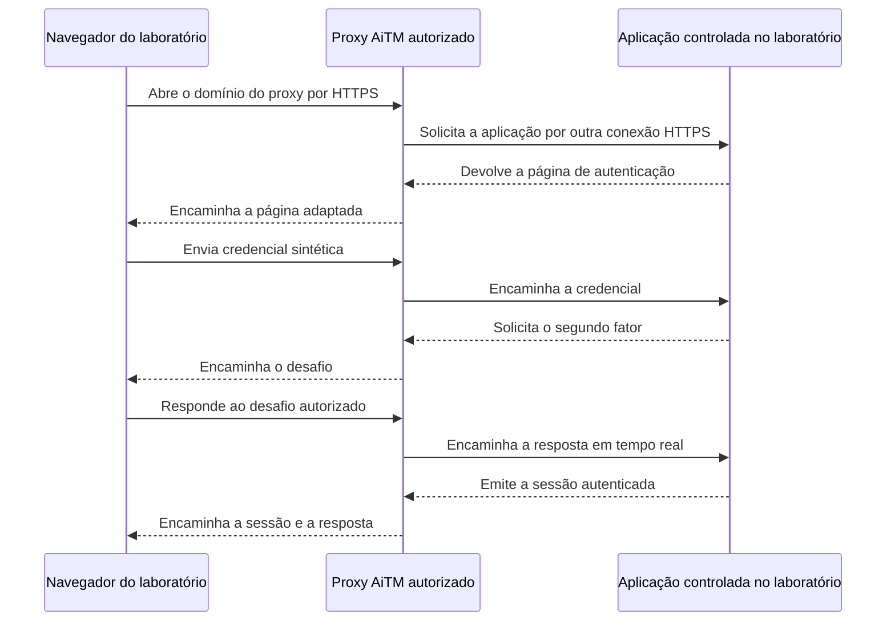

# Intermediando uma autenticação em tempo real

Você entra em uma aplicação, informa a senha, confirma o segundo fator e começa a navegar. Na página seguinte, ela não pede tudo de novo. Ainda bem: ninguém quer fazer uma prova de identidade a cada clique. Mas como o serviço sabe que aquele novo pedido continua sendo seu?

A resposta envolve uma sessão. E ela muda a pergunta desta aula: em vez de olhar apenas para a senha digitada, vamos acompanhar o que a aplicação cria **depois de aceitar o login**. É nesse momento que aparece um segredo diferente, capaz de representar o acesso já autorizado.

O instrutor usou o **Evilginx** para apresentar essa relação. A ferramenta pode atuar como um intermediário entre navegador e aplicação, posição chamada **Adversary-in-the-Middle (AiTM)**. Aqui, estudaremos o mecanismo em ambiente próprio e isolado, com aplicação controlada e identidades sintéticas. Nenhuma conta, credencial, sessão ou serviço de terceiros faz parte do exercício. A demonstração ainda não foi reproduzida neste laboratório.

## O limite de uma página estática

Uma página pode ter a aparência de uma tela de entrada sem participar da autenticação verdadeira. Receber o texto de um campo não faz a aplicação original aceitar aquela pessoa. A cópia visual e o serviço que verifica a identidade são coisas diferentes.

Isso fica mais claro quando existe um segundo fator. Na **Two-Factor Authentication (2FA)**, a aplicação exige duas categorias de evidência, como uma senha e a prova de posse de um dispositivo. **Multi-Factor Authentication (MFA)** é o nome mais amplo para o uso de dois ou mais fatores independentes. Duas telas de senha não viram dois fatores só porque ocupam páginas separadas.

Agora imagine uma página que guarda o primeiro valor e mostra um erro. Ela não recebe automaticamente o desafio verdadeiro, não entrega a resposta ao serviço e não ganha uma sessão autenticada por ter imitado o formulário. Falta a conversa com quem realmente decide se o login será aceito.

O modelo apresentado nesta seção muda justamente essa conversa. Um intermediário acompanha as mensagens enquanto elas circulam. Não se trata apenas de guardar uma fotografia da entrada: há um programa recebendo pedidos de um lado e fazendo pedidos do outro.

## O que um proxy reverso faz

Pense em um atendimento que recebe uma solicitação e precisa consultar outro serviço para responder. Há duas conversas: uma com quem pediu e outra com quem fornece a informação. Essa é uma aproximação útil para entender um **proxy**, processo que recebe uma comunicação e abre outra para encaminhá-la.

A comparação para aí: um proxy não é uma pessoa lendo recados. Ele trabalha com conexões, protocolos e mensagens. Proxies reversos são usados legitimamente para publicar aplicações, distribuir carga e aplicar políticas. O nome da arquitetura não determina sua finalidade; autorização e tratamento dos dados fazem parte dessa avaliação.

No laboratório conceitual, os dois trechos são:

1. navegador do participante para o proxy, usando o domínio e o certificado TLS do laboratório;
2. proxy para a aplicação, usando o domínio e o certificado TLS da aplicação.

Repare no detalhe: **duas conexões protegidas não significam uma única conexão de ponta a ponta entre navegador e aplicação**. O primeiro TLS termina no proxy. Por controlar a identidade criptográfica que apresenta nesse trecho, ele recebe ali o conteúdo decifrado. Depois, atua como cliente de outra conexão TLS até a aplicação. Não precisa quebrar a criptografia dela para ocupar essa posição.

O navegador continua mostrando o domínio ao qual se conectou: o do intermediário. O cadeado, ou outro indicador equivalente do navegador, não transforma esse nome no domínio da aplicação. A proteção vale para a conexão estabelecida, com a identidade apresentada naquele endereço.

Há ainda um trabalho de compatibilidade. Uma aplicação usa hosts, links, cabeçalhos, formulários e cookies que precisam continuar fazendo sentido ao atravessar o intermediário. Os arquivos de regras específicos desse fluxo são chamados **phishlets**. Eles não são apenas uma página salva: descrevem elementos que a ferramenta deve reconhecer e adaptar. Se a aplicação muda, a regra pode deixar de corresponder a ela.

O nome Evilginx também merece cuidado. Ele vem de uma versão antiga que modificava Nginx; a versão atual é uma aplicação independente escrita em Go. Não confunda o framework estudado com o servidor Nginx convencional, usado em muitos ambientes legítimos.

## Da senha à sessão autenticada

Depois de verificar os fatores, a aplicação precisa reconhecer os pedidos seguintes. Para isso, normalmente cria uma **sessão**: um estado que relaciona aquela navegação à identidade que acabou de ser autenticada.

Uma comparação ajuda. A senha e o segundo fator participam da verificação na entrada; a sessão se parece com uma credencial temporária de circulação concedida depois dela. Não é um crachá literal: tecnicamente, o navegador costuma guardar um identificador ou token opaco em um ou mais cookies, e a aplicação verifica esses dados nas requisições posteriores.

“Opaco” quer dizer que o valor não precisa explicar seu significado para quem o lê. Uma sequência aparentemente sem sentido ainda pode representar um acesso importante. **Não conter a senha não torna o token inofensivo.** Enquanto aceito, ele pode relacionar um pedido à sessão da conta.

O esquema abaixo descreve a sequência conceitual da demonstração, não uma autenticação já reproduzida neste workspace:

Primeiro, as entradas da autenticação atravessam o intermediário. O desafio do segundo fator volta pelo mesmo caminho, e a resposta do participante segue enquanto ainda é válida. Até aqui, ninguém deve concluir que a sessão existe: **quem verifica os fatores e decide emitir a sessão é a aplicação**.

Se essa decisão for favorável, a resposta que representa o estado autenticado também passa pelo proxy. Isso explica por que um intermediário capaz de reconhecer esses elementos pode observá-los. Apresentar posteriormente esses dados em outro cliente é uma tentativa de **session replay**, ou reutilização de sessão. Observar um token e conseguir reutilizá-lo são resultados distintos.

## Por que isso não quebra o MFA

Vamos separar dois momentos. Antes da validação, a aplicação está perguntando quem quer entrar. Depois, ela já pode ter concedido uma sessão. Atacar o estado criado no segundo momento não demonstra que o desafio do primeiro foi descoberto ou quebrado.

É por isso que “bypass de MFA” pode descrever uma aparência sem explicar bem a causa. Se outro cliente é aceito com uma sessão já autenticada, ele parece ter pulado o segundo fator. Mas, no mecanismo estudado, o participante respondeu ao desafio verdadeiro, e a aplicação validou a resposta. O problema está na exposição e eventual aceitação posterior da sessão.

Os prazos também podem ser diferentes. Um código temporário pode vencer em segundos, enquanto a sessão continua válida pelo período escolhido pelo serviço. A senha é uma entrada do login; o token pode representar o estado resultante. Guardar uma não equivale automaticamente a obter o outro.

Nem por isso qualquer cookie concede “controle total”. A aplicação pode exigir vários valores, estado no navegador ou no servidor, vínculo ao dispositivo e novas verificações para ações sensíveis. Expiração, revogação e mudanças de contexto também influenciam a aceitação. Um teste só sustenta uma conclusão sobre as condições realmente verificadas.

As **passkeys** e chaves de segurança baseadas em WebAuthn acrescentam uma diferença importante: a operação criptográfica é vinculada à origem. O navegador considera o domínio aberto. Um nome parecido não recebe uma assinatura válida para a origem legítima só porque a página tem aparência convincente. Essa propriedade torna o método resistente ao fluxo de phishing intermediado descrito aqui, sem transformar todos os aspectos de uma conta em invulneráveis.

## O que foi observado na demonstração

No curso, o instrutor mostrou primeiro valores de um login por senha no console da ferramenta. Depois, apresentou uma conta que concluiu o segundo fator através do proxy. Dados descritos como de sessão foram levados a outro navegador, que apareceu autenticado.

Esse é o tamanho da evidência disponível: **observações da demonstração do curso**. O fluxo não foi reproduzido neste workspace, e nenhum valor de senha, código, cookie ou token da apresentação foi preservado. Não há fundamento para transformar dois exemplos em garantia de funcionamento contra qualquer serviço ou fator.

Em um laboratório próprio, a investigação precisaria distinguir:

- o domínio que o navegador realmente abriu;
- as duas conexões TLS e seus destinos;
- o momento em que a aplicação de laboratório solicitou e validou os fatores;
- a emissão de uma sessão sintética;
- a aceitação ou recusa dessa sessão em outro contexto;
- a revogação e remoção de todos os artefatos ao final.

Essas observações não exigem publicar o segredo. Um registro com rótulos e identificadores fictícios pode mostrar que o estado mudou. Exibir um token válido apenas acrescenta risco ao material que será compartilhado.

## Limites do laboratório autorizado

Ter a chave de um laboratório não dá a chave de todos os prédios da rua. Da mesma forma, controlar o proxy não concede autorização sobre uma plataforma externa. A aplicação de destino, as identidades e os participantes precisam estar cobertos pelo exercício. Uma conta pessoal em um serviço não transfere ao estudante autoridade sobre a infraestrutura desse serviço.

Fora desse escopo, a coleta de credenciais ou sessões pode permitir assumir identidades e causar dano. Também não há invisibilidade: DNS, certificados, nuvem, requisições HTTP e eventos da aplicação deixam registros. Estudar o mecanismo exige reconhecer esses rastros, não prometer anonimato.

Na próxima aula, mudaremos a pergunta. Em vez de acompanhar a autenticação, vamos distinguir código baixado, programa compilado e serviços configurados. O console abrir será uma evidência útil, mas continuará longe de provar que uma autenticação completa funcionou.
