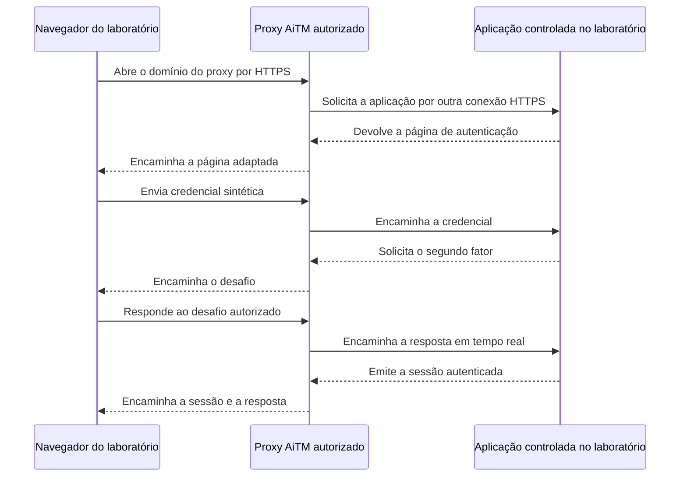

# Intermediando uma autenticação em tempo real

> **Status:** publicado; demonstração ainda não reproduzida em laboratório.
>
> **Título original:** Introduction to Evilginx
>
> **Escopo:** compreensão conceitual de um proxy reverso adversário em ambiente próprio e isolado. Nenhuma conta, credencial, sessão ou serviço de terceiros deve participar do exercício.

Nas aulas anteriores, uma página estática recebia um formulário e podia registrar os valores enviados. Esse modelo ajuda a compreender requisições HTTP, processamento no servidor e armazenamento, mas para quando o site legítimo exige uma etapa adicional de autenticação. A pergunta desta aula é por que intermediar a autenticação **enquanto ela acontece** também pode expor a sessão criada depois do segundo fator.

O exemplo apresentado pelo instrutor utiliza **Evilginx**, um framework que assume a posição de **Adversary-in-the-Middle (AiTM)** entre o navegador e uma aplicação web. O nome do projeto vem de uma versão antiga baseada em uma modificação do Nginx; a versão atual do projeto é uma aplicação independente escrita em Go. Portanto, Evilginx não deve ser confundido com o servidor web Nginx instalado normalmente em milhares de serviços legítimos.

## O limite de uma página estática

Em uma autenticação baseada somente em senha, copiar usuário e senha pode fornecer o segredo necessário para uma nova tentativa de login. Quando existe **Two-Factor Authentication (2FA)**, ou autenticação de dois fatores, o serviço exige duas categorias de evidência, como senha e código temporário. **Multi-Factor Authentication (MFA)** é o termo mais amplo para autenticação com dois ou mais fatores independentes.

Uma página estática consegue receber o que o participante digita, mas não participa automaticamente da conversa com o serviço legítimo. Se apenas armazenar a senha e mostrar um erro, ela não conduz o navegador ao desafio de MFA, não apresenta a resposta real do serviço e não recebe a sessão autenticada criada ao final.

O proxy reverso muda essa arquitetura. Em vez de encerrar o fluxo na página controlada pelo operador, ele encaminha mensagens entre os dois lados em tempo real.

## O que um proxy reverso faz

Um **proxy** é um processo que recebe uma comunicação em nome de outro lado e inicia uma segunda comunicação para encaminhá-la. Em usos legítimos, proxies reversos podem distribuir carga, aplicar políticas ou publicar aplicações internas. O comportamento não é malicioso por natureza; finalidade, autorização e tratamento dos dados determinam o uso.

No cenário estudado, o navegador se conecta ao domínio do laboratório, e o proxy abre outra conexão com a aplicação de destino. São duas conexões distintas:

1. navegador do participante para o proxy, usando o domínio e o certificado TLS do laboratório;
2. proxy para a aplicação, usando o domínio e o certificado TLS da aplicação.

O proxy decifra a primeira conexão porque controla sua própria chave TLS, lê ou transforma a mensagem e a cifra novamente na segunda conexão. Ele não quebra a criptografia TLS da aplicação. O navegador também não está conectado diretamente ao domínio legítimo: o nome completo exibido na barra de endereços continua sendo uma evidência essencial.

Para manter a navegação funcional, a ferramenta precisa adaptar hosts, links, cabeçalhos, formulários e cookies que atravessam o proxy. No Evilginx, as regras específicas de um fluxo são descritas por arquivos chamados **phishlets**. Um phishlet não é apenas uma cópia visual de uma página; ele define como determinados hosts e elementos do protocolo serão intermediados. Essas definições dependem do comportamento da aplicação e podem deixar de funcionar quando esse comportamento muda.

## Da senha à sessão autenticada

Depois de validar os fatores exigidos, uma aplicação web normalmente cria uma **sessão**. A sessão permite que o usuário continue navegando sem reenviar senha e segundo fator a cada requisição.

O navegador costuma guardar em um ou mais cookies um identificador ou token opaco associado a essa sessão. Enquanto esse segredo estiver válido, o servidor pode aceitar requisições como pertencentes à conta autenticada. Por isso, um token de sessão deve ser protegido como uma credencial, mesmo que não revele a senha.

O fluxo conceitual demonstrado na aula foi este:

O participante fornece a senha ao domínio do proxy. O proxy consegue observá-la antes de encaminhá-la. Se a aplicação solicitar um código temporário, o desafio retorna pelo mesmo caminho. Quando o participante responde corretamente, o proxy transmite a resposta ainda válida. A aplicação realiza a verificação legítima e, se todas as condições forem satisfeitas, emite os dados da sessão.

Como esses dados também atravessam o intermediário, uma implementação configurada para reconhecê-los pode registrá-los. A tentativa posterior de apresentar uma sessão capturada em outro cliente é chamada de **session replay**, ou reutilização de sessão.

## Por que isso não quebra o MFA

A expressão “bypass de MFA” descreve o resultado aparente de uma reutilização bem-sucedida: outro cliente acessa uma sessão sem digitar novamente o segundo fator. O mecanismo, porém, não descobre o código nem rompe a criptografia do MFA. O próprio participante resolveu o desafio correto, e o proxy aproveitou a sessão que o serviço emitiu depois dessa autenticação válida.

Essa distinção explica por que obter somente a senha não produz o mesmo efeito. A senha atua durante a autenticação; o token representa o estado criado após a autenticação. O código temporário pode expirar em segundos, enquanto a sessão pode permanecer válida por outro período definido pelo serviço.

Também não se deve concluir que qualquer cookie isolado concede “controle total”. Uma aplicação pode usar vários cookies, tokens adicionais e estado mantido no navegador ou no servidor. Ela pode vincular a sessão ao dispositivo, impor prazo curto, detectar mudança de contexto, exigir nova autenticação para ações sensíveis ou revogar a sessão. Cada resultado precisa ser comprovado no ambiente e na versão realmente testados.

Credenciais vinculadas à origem, como passkeys e chaves de segurança baseadas em WebAuthn, acrescentam outra limitação importante. O navegador relaciona a operação criptográfica ao domínio que está aberto. Um domínio semelhante controlado pelo proxy não recebe uma assinatura válida para a origem legítima, o que torna esse método resistente ao fluxo de phishing intermediado descrito aqui.

## O que foi observado na demonstração

O instrutor mostrou duas situações. Na primeira, uma autenticação baseada em senha foi encaminhada e os valores apareceram no console da ferramenta. Na segunda, uma conta de demonstração com segundo fator concluiu o login através do proxy; depois, dados apresentados como pertencentes à sessão foram importados em outro navegador, que apareceu autenticado.

Essas são **observações da demonstração do curso**, não resultados validados neste workspace. Nenhum valor de senha, código temporário, cookie ou token mostrado na aula foi preservado. A demonstração também não prova que uma única técnica funcione contra todos os serviços, todos os tipos de MFA ou todos os controles de sessão.

Uma validação autorizada teria de mostrar separadamente:

- o domínio que o navegador realmente abriu;
- as duas conexões TLS e seus destinos;
- o momento em que a aplicação de laboratório solicitou e validou os fatores;
- a emissão de uma sessão sintética;
- a aceitação ou recusa dessa sessão em outro contexto;
- a revogação e remoção de todos os artefatos ao final.

Logs e capturas destinados ao livro não devem conter os próprios segredos. Rótulos, horários e identificadores fictícios são suficientes para explicar a mudança de estado.

## Limites do laboratório autorizado

Controlar o servidor do proxy não concede autorização sobre uma plataforma externa. Um teste seguro exige uma aplicação ou provedor de identidade criado para o laboratório, contas sintéticas e consentimento explícito de todos os participantes. Encaminhar logins de terceiros, mesmo usando uma conta pessoal, pode afetar infraestrutura fora do escopo e violar termos de serviço.

Fora de uma avaliação formalmente autorizada, coletar credenciais ou sessões permite assumir identidades e causa dano direto. O domínio, as mensagens e a infraestrutura também deixam rastros em DNS, certificados, logs da nuvem, registros HTTP e eventos da aplicação.

A próxima aula separará as camadas necessárias para iniciar a ferramenta em uma instância descartável: código-fonte, compilação, portas, DNS autoritativo, TLS e configuração interativa. Instalar ou abrir o programa será apenas uma mudança de estado local; não provará que o DNS, os certificados ou um fluxo de autenticação estejam funcionando.

## Referências

- [Repositório oficial do Evilginx](https://github.com/kgretzky/evilginx2)
- [O que o HTTPS protege](../03-phishing/18-introduction-to-https.md)
- [Emitindo e instalando um certificado com Certbot](../03-phishing/19-enabling-https-on-phishing-pages.md)
