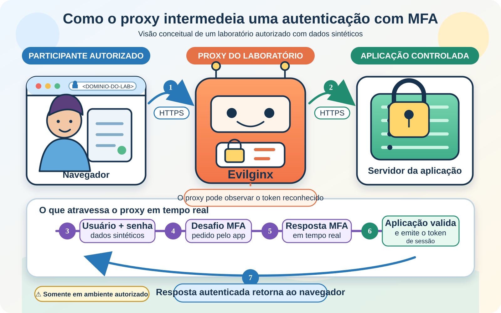

# Do phishlet carregado à sessão autenticada

> **Status:** publicado. A carga dos phishlets e a correção da blacklist funcionaram no laboratório do estudante; o fluxo completo de autenticação e a reutilização de sessão ainda não foram reproduzidos neste workspace.
>
> **Título original:** Bypassing 2FA / MFA
>
> **Escopo:** estudo em infraestrutura própria, com aplicação e identidades sintéticas. Credenciais, códigos MFA e sessões de serviços de terceiros não devem ser usados, mesmo quando a conta pertence ao operador do laboratório.

Nas aulas preparatórias, vimos por que um proxy **Adversary-in-the-Middle (AiTM)** consegue observar a autenticação enquanto ela acontece e como preparar o executável, o domínio e os serviços de rede. Restava transformar esses componentes separados em um fluxo: carregar regras compatíveis, associá-las ao domínio do laboratório, ativá-las, criar um endereço de entrada e observar o estado da sessão.

A aula chamou esse resultado de “bypass de 2FA/MFA”. Tecnicamente, o segundo fator não é quebrado. O participante conclui a autenticação verdadeira através do proxy, e a aplicação emite uma sessão já autenticada. Se os dados dessa sessão forem capturados e aceitos em outro cliente, este poderá aparentar ter “pulado” o MFA porque o serviço não solicita novamente os fatores em cada requisição.

## Carregando as regras que faltavam

Um **phishlet** é um arquivo YAML com as regras usadas pelo Evilginx para intermediar um fluxo web. Ele descreve hosts, parâmetros e elementos da sessão que a ferramenta precisa reconhecer. Não é apenas uma cópia visual de uma página, e não existe garantia de que continue compatível depois que a aplicação de destino muda.

No laboratório, o executável estava em `/home/kali/evilginx2/build/evilginx`, enquanto os phishlets adicionais foram clonados em outro diretório. O histórico que levou ao funcionamento foi normalizado abaixo, sem os números do `history` e sem os caracteres `\n` que representavam apenas quebras de linha:

```bash
cd /home/kali
git clone https://github.com/An0nUD4Y/Evilginx-Phishlets.git
cd Evilginx-Phishlets
ls
cd ../evilginx2
build/evilginx -p phishlets
```

`git clone` criou `/home/kali/Evilginx-Phishlets` com uma cópia do repositório remoto. `ls` permitiu observar o conteúdo baixado. Depois, `cd ../evilginx2` deixou o shell no diretório do código compilado.

O último comando tem duas partes importantes. `build/evilginx` é o caminho relativo até o executável, e `-p phishlets` informa onde procurar os arquivos YAML. Como `phishlets` também é um caminho relativo, ele é resolvido a partir do diretório atual. Nesse caso, aponta para `/home/kali/evilginx2/phishlets`.

Executar a ferramenta antes da cópia ajudou a separar o problema: ter arquivos em `/home/kali/Evilginx-Phishlets` não fazia o processo carregá-los automaticamente. Eles precisavam estar no diretório indicado por `-p`, ou esse argumento precisaria apontar diretamente para outro diretório compatível.

O ajuste realizado no laboratório foi:

```bash
cp /home/kali/Evilginx-Phishlets/*.yaml /home/kali/evilginx2/phishlets/
build/evilginx -p phishlets
```

O shell expande `*.yaml` para os arquivos YAML encontrados no diretório de origem. `cp` copia esses arquivos para o diretório que o Evilginx examina na inicialização. O segundo comando reinicia a ferramenta e provoca uma nova leitura das regras.

Essa origem de phishlets é comunitária e não pertence ao repositório oficial do Evilginx. Arquivos de terceiros podem estar desatualizados, conter regras incompatíveis ou introduzir transformações que não foram auditadas. Eles devem ser examinados e associados a um hash de commit conhecido antes de qualquer laboratório. A cópia também pode sobrescrever arquivos de mesmo nome no destino; por isso, esse procedimento pertence a uma instância descartável, nunca a um ambiente de produção.

## Quando o próprio IP entra na blacklist

Depois da cópia, ainda havia um segundo estado persistente interferindo no teste. O Evilginx mantém uma **blacklist**, ou lista de bloqueio, no diretório de configuração do usuário que iniciou o processo. Como a ferramenta estava sendo executada como `root`, o arquivo usado era:

```text
/root/.evilginx/blacklist.txt
```

Na configuração padrão atual, uma requisição considerada não autorizada pode adicionar o endereço IP de origem a esse arquivo. Isso pode acontecer, por exemplo, quando alguém abre uma URL que não corresponde a uma lure ativa ou tenta acessar uma lure cujo phishlet está desabilitado ou oculto. Assim, visitar diretamente o domínio durante a preparação do laboratório pode bloquear o próprio IP público usado no teste.

Um endereço IP identifica uma interface na comunicação de rede. Quando o navegador sai para a Internet através de um roteador com **Network Address Translation (NAT)**, o servidor normalmente observa o IP público compartilhado, não o endereço privado do computador. Portanto, bloquear esse IP pode afetar outros clientes que saem pelo mesmo roteador.

O histórico mostra a limpeza que permitiu continuar:

```bash
rm /root/.evilginx/blacklist.txt
build/evilginx -p phishlets
```

`rm` removeu o arquivo persistente inteiro, incluindo qualquer outro IP ou faixa que estivesse nele. Na inicialização seguinte, o Evilginx recriou um arquivo vazio e carregou a blacklist novamente. Reiniciar é importante porque o processo também mantém os endereços já lidos em memória; apagar o arquivo enquanto a mesma execução continua não limpa esse estado interno.

Essa remoção não é uma correção geral para falhas de DNS, TLS ou parsing de YAML. Ela só é coerente quando o operador confirma que o próprio IP autorizado foi bloqueado por engano. Antes de remover o arquivo, o correto é parar a ferramenta, inspecionar o conteúdo, confirmar a origem do bloqueio e preservar somente as entradas que ainda façam sentido. Se o processo fosse iniciado como o usuário `kali`, o diretório de configuração padrão estaria sob `/home/kali/.evilginx`, e não sob `/root`.

O resultado informado pelo estudante foi que, após copiar os YAML, limpar a blacklist e iniciar novamente com `-p phishlets`, a ferramenta passou a funcionar no laboratório. Sem a saída do console, esse histórico comprova a sequência executada, mas não permite afirmar sozinho quais arquivos foram aceitos nem qual mensagem específica desapareceu.

## Associando um phishlet ao domínio do laboratório

Dentro do console interativo do Evilginx, o comando `phishlets` lista as regras reconhecidas. A tradução automática da aula transformou *phishlet* em expressões como “lista de peixes”, “fenda de peixe” e “fish lit”; todas se referiam ao mesmo componente.

Antes de ativar uma regra, a versão mostrada pelo instrutor exigia associá-la a um hostname:

```text
phishlets hostname <PHISHLET-DO-LAB> <DOMINIO-DO-LAB>
phishlets enable <PHISHLET-DO-LAB>
```

O primeiro comando vincula o phishlet ao domínio controlado pelo laboratório. O segundo muda seu estado para habilitado. Habilitar não cria registros DNS: a zona do domínio ainda precisa fazer cada hostname exigido pelo phishlet resolver para o IP público da instância.

Na demonstração, a primeira ativação falhou durante a obtenção do certificado TLS e revelou dois subdomínios sem registros correspondentes. O erro foi útil porque mostrou quais nomes a regra tentava publicar. O instrutor criou registros DNS para esses nomes, apontando-os para o mesmo servidor, aguardou a propagação e tentou novamente.

Essa falha não acontece obrigatoriamente na primeira execução. Ela ocorre quando algum pré-requisito ainda não foi satisfeito, como resolução DNS incorreta, propagação incompleta, porta necessária bloqueada ou configuração incompatível. Os hostnames exatos também dependem do phishlet; não existe uma lista universal de subdomínios.

Um registro `A` relaciona um nome a um endereço IPv4. Quando o navegador consulta esse nome, o DNS devolve o IP da instância; o tráfego pode então chegar ao Security Group da nuvem, ao firewall do sistema e, por fim, ao processo que escuta a porta correspondente. Abrir uma porta no Security Group não inicia o serviço, e iniciar o Evilginx não garante que DNS e firewalls permitam alcançá-lo.

Para HTTPS, ainda é necessário um certificado válido para os nomes publicados. A emissão automática pela autoridade certificadora comprova controle técnico sobre o domínio solicitado, não que a página seja confiável. O navegador estabelece TLS com o domínio do proxy, enquanto o proxy estabelece outra conexão com a aplicação controlada no laboratório. São duas conexões separadas.

## Criando a rota de entrada

Um phishlet habilitado define como o tráfego será intermediado, mas ainda não fornece necessariamente uma URL de entrada. O Evilginx chama essa entrada de **lure**. Na versão apresentada na aula, o instrutor usou:

```text
lures create <PHISHLET-DO-LAB>
lures
```

O primeiro comando cria uma lure associada ao phishlet. O segundo lista as lures e seus identificadores. Na demonstração, a primeira recebeu o ID `0` e um caminho aleatório. O ID identifica o objeto dentro do Evilginx; ele não é porta de rede, endereço IP nem parte da autenticação.

O caminho foi alterado e a URL consultada com comandos equivalentes a:

```text
lures edit 0 path <CAMINHO-DO-LAB>
lures get-url 0
```

Personalizar o caminho muda a parte da URL que aparece depois do domínio. Não altera o destino DNS, o certificado, o phishlet associado nem as permissões da aplicação. Em um exercício autorizado, o caminho deve apenas identificar a rota de teste. Torná-lo parecido com uma marca para induzir terceiros ao erro ultrapassa o escopo do laboratório.

A URL só deve ser aberta por participantes autorizados e deve usar um domínio de laboratório. O instrutor demonstrou um phishlet relacionado a um serviço externo; este capítulo não transforma essa demonstração em autorização para intermediar uma plataforma real. Nem mesmo uma conta pessoal concede permissão para colocar a infraestrutura do provedor no fluxo do teste.

## O que acontece durante a autenticação

Ao abrir a lure válida, o navegador inicia uma sessão de phishing registrada pela ferramenta. A sequência conceitual é:



*O navegador e o Evilginx encerram uma conexão HTTPS, enquanto o Evilginx inicia outra conexão HTTPS com a aplicação controlada. Credenciais sintéticas e a resposta MFA atravessam o proxy, mas somente a aplicação valida os fatores e emite o token que representa a sessão autenticada.*

1. o navegador se conecta por HTTPS ao domínio do laboratório;
2. o Evilginx abre outra conexão com a aplicação controlada;
3. usuário e senha sintéticos atravessam o proxy e são encaminhados;
4. a aplicação solicita o segundo fator;
5. a resposta MFA também atravessa o proxy em tempo real;
6. a aplicação valida os fatores e emite os dados da sessão autenticada;
7. o proxy encaminha a resposta ao navegador e pode registrar os elementos que o phishlet reconhece como tokens.

Depois da senha, mas antes do segundo fator, a captura da credencial ainda não representa uma sessão autenticada. Somente a aplicação de destino decide se os fatores são válidos. Depois da validação, cookies ou outros tokens podem representar o estado autenticado sem conter a senha nem o código MFA.

O console apresentado pelo instrutor permitia listar e detalhar o histórico com:

```text
sessions
sessions <ID-DA-SESSAO>
```

`sessions` mostra registros como phishlet, horário, IP de origem e indicação de tokens capturados. `sessions <ID-DA-SESSAO>` abre os detalhes de um registro específico. Esses dados podem incluir credenciais e cookies válidos; portanto, são segredos e não devem aparecer em screenshots, commits ou notas públicas.

Na demonstração do curso, dados apresentados como cookies da sessão foram importados em outro navegador, que apareceu autenticado sem repetir usuário, senha e MFA. Essa é uma observação do instrutor, não um resultado reproduzido neste workspace. Também não prova que qualquer cookie isolado seja suficiente: uma aplicação pode exigir vários tokens, manter estado no servidor, vincular a sessão ao dispositivo, detectar mudança de contexto, expirar o acesso ou solicitar nova autenticação.

## O que foi e o que não foi validado

O laboratório do estudante confirmou que a localização dos arquivos e o estado persistido da blacklist eram relevantes. A sequência final carregou os YAML no diretório indicado por `-p`, removeu a lista de bloqueio criada sob a conta `root` e reiniciou o processo.

O relato não inclui evidências suficientes para afirmar que também foram validados:

- todos os phishlets copiados e sua compatibilidade com a versão compilada;
- resolução DNS de cada hostname necessário;
- emissão e cadeia de confiança do certificado TLS;
- autenticação completa contra uma aplicação controlada;
- captura de uma sessão sintética;
- aceitação ou recusa da sessão em outro navegador.

Cada item representa uma mudança de estado diferente. Ver o executável abrir não comprova DNS; resolver o domínio não comprova que a porta esteja acessível; receber uma página por HTTPS não comprova que o phishlet reconheça o fluxo; e registrar um token não comprova que ele possa ser reutilizado.

## Encerrando sem deixar credenciais ou infraestrutura expostas

Ao final de um laboratório autorizado, as lures e os phishlets devem ser desabilitados, e o processo precisa ser encerrado. Registros de sessão, credenciais sintéticas, cookies, arquivos YAML de terceiros e bancos de dados locais devem ser revisados e removidos conforme o plano do exercício. As sessões da aplicação precisam ser revogadas, não apenas apagadas do Evilginx.

Também é necessário remover os registros DNS temporários, fechar as regras de entrada abertas para o teste e terminar a instância quando ela não tiver mais função. Sair do SSH encerra apenas o terminal remoto; a máquina virtual pode continuar ligada e gerando custos.

Os principais artefatos deixados por essa prática são registros DNS, certificados emitidos, regras de firewall ou Security Group, logs da instância, histórico da aplicação, banco de sessões e o arquivo de blacklist. Eles ajudam a reconstruir o que ocorreu, mas qualquer material destinado ao livro deve substituir IPs, domínios, identidades e tokens por valores fictícios.

## Referências

- [Evilginx — repositório oficial](https://github.com/kgretzky/evilginx2)
- [Evilginx Community — Phishlets](https://help.evilginx.com/community/guides/phishlets)
- [Evilginx Community — Blacklist](https://help.evilginx.com/community/guides/blacklist)
- [Evilginx Community — Lures](https://help.evilginx.com/community/guides/lures)
- [Evilginx Community — Sessions](https://help.evilginx.com/community/guides/sessions)
